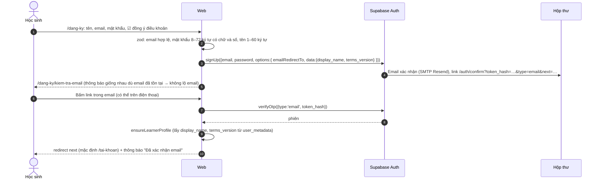

# Kế hoạch: Tài khoản học sinh (đăng ký, đăng nhập, Google) và hoàn thiện Thanh toán

> Dự án: Lịch sử Việt Nam 12 — `tronghp160/WEB_LICH-SU_12`, nhánh `main` tại commit `51180e4`
> (Merge PR #3 `feat/thanh-toan`). Ngày rà soát: 14/10/2026.
> Đặt file này ở `docs/ke-hoach-tai-khoan.md` trong repo để Claude Code đọc khi làm từng giai đoạn.

---

## Mục lục

1. [Tóm tắt](#1-tóm-tắt)
2. [Hiện trạng repo — đã làm đến đâu](#2-hiện-trạng-repo)
3. [Thanh toán đã ổn chưa? Những việc còn phải làm](#3-thanh-toán-đã-ổn-chưa)
4. [Thiết kế tài khoản học sinh](#4-thiết-kế-tài-khoản-học-sinh)
5. [Cơ sở dữ liệu (migration mới)](#5-cơ-sở-dữ-liệu)
6. [Luồng xử lý chi tiết](#6-luồng-xử-lý-chi-tiết)
7. [Gắn tài khoản với tiến độ và thanh toán](#7-gắn-tài-khoản-với-tiến-độ-và-thanh-toán)
8. [Danh sách tệp cần tạo / sửa](#8-danh-sách-tệp-cần-tạo--sửa)
9. [Cấu hình Google Cloud và Supabase (làm tay)](#9-cấu-hình-google-cloud-và-supabase)
10. [Bảo mật — checklist](#10-bảo-mật--checklist)
11. [Quyền riêng tư và người dùng chưa đủ 18 tuổi](#11-quyền-riêng-tư)
12. [Kiểm thử](#12-kiểm-thử)
13. [Lộ trình triển khai](#13-lộ-trình-triển-khai)
14. [Câu lệnh mẫu cho Claude Code theo từng giai đoạn](#14-câu-lệnh-mẫu-cho-claude-code)
15. [Rủi ro và các quyết định cần chốt](#15-rủi-ro-và-quyết-định-cần-chốt)

---

## 1. Tóm tắt

**Hiện trạng:** chức năng thanh toán đã làm đủ giai đoạn 1–5 theo `docs/ke-hoach-thanh-toan.md`, có cả cổng payOS thật.
Code chất lượng tốt: lint sạch, `tsc` sạch, **491/491 unit test** đạt, build production thành công.

**Thanh toán chưa thể coi là xong.** Còn 3 việc **bắt buộc**:
1. **Nội dung không khớp lời hứa:** trang `/luyen-thi` ghi "10 đề × 40 câu, 50 phút" nhưng hiện chỉ có **đề 2 (10 câu)**
   thuộc gói trả phí. Bán 29.000đ như vậy là sai mô tả.
2. **Chưa kiểm chứng trên môi trường thật:** chưa có ghi nhận E2E, kiểm thử SQL và một giao dịch payOS thật trên bản deploy.
   `README.md` và `docs/test-report.md` chưa cập nhật phần thanh toán.
3. **Người mua dễ mất mã kích hoạt:** web chưa gửi email. Nếu người mua không nhập email và mất cookie (đổi máy, xóa dữ
   liệu duyệt web) thì mất mã vĩnh viễn. Phần tài khoản (bên dưới) giải quyết tận gốc chuyện này.

**Tài khoản học sinh (mới):**
- Đăng ký / đăng nhập bằng **email + mật khẩu** (có xác nhận email) và bằng **Google**.
- Có quên mật khẩu, đặt lại mật khẩu, đổi mật khẩu, trang "Tài khoản của em", xóa tài khoản.
- **Không bắt buộc đăng nhập để học.** Ai không đăng nhập vẫn dùng web như hiện tại (tiến độ lưu trên trình duyệt).
- Lợi ích khi đăng nhập:
  - tiến độ và Hộ chiếu **đồng bộ mọi máy**;
  - gói luyện thi **gắn với tài khoản**, không cần nhập mã, không tốn lượt thiết bị;
  - xem lại đơn hàng và mã đã mua.

**Kỹ thuật:** dùng **Supabase Auth** có sẵn (nhân sự đang dùng). Đăng nhập Google theo luồng **PKCE phía server**
(`signInWithOAuth` → `/auth/callback` → `exchangeCodeForSession`). Học sinh và nhân sự phân biệt bằng bảng hồ sơ: quyền
nội bộ vẫn chỉ do `staff_profiles` quyết định. Mình đã rà toàn bộ RLS: tài khoản học sinh mới **không có thêm quyền
gì** đối với dữ liệu nội bộ.

**Khối lượng:** phần hoàn thiện thanh toán khoảng **3–4 ngày** (chưa tính soạn đề). Phần tài khoản khoảng **8–10 ngày**.

---

## 2. Hiện trạng repo

### 2.1. Kết quả kiểm tra tự động (chạy lại ngày 14/10/2026)

| Kiểm tra | Kết quả |
|---|---|
| `npm run lint` | ✅ sạch |
| `npx tsc --noEmit` | ✅ sạch |
| `npm test` (Vitest) | ✅ **491/491**, 34 file (thêm 57 test so với trước phần thanh toán) |
| `next build` | ✅ thành công (Next.js 16.3.8) |
| `npm audit --omit=dev` | ✅ 0 lỗ hổng |
| E2E Playwright, `supabase/tests/payments.sql` | ⚠️ chưa chạy lại được ở đây vì cần database thật. Có 18 ca E2E thanh toán (`payments.spec.ts` 13 ca, `payments-admin.spec.ts` 5 ca) |

### 2.2. Tiến độ theo kế hoạch thanh toán

| Giai đoạn | Nội dung | Trạng thái |
|---|---|---|
| GĐ1 Nền tảng | Migration `20261015000000_payments.sql` (7 bảng, 13 policy, 4 hàm nghiệp vụ, 2 trigger toàn vẹn), seed, hàm thuần + unit test | ✅ Xong |
| GĐ2 Cổng giả lập + luồng mua | Cổng `mock`, trang ngân hàng giả lập, webhook, trang kết quả có đối soát | ✅ Xong |
| GĐ3 Kích hoạt + đề | `/kich-hoat`, `useLicense`, `get_exam_set`, `/luyen-thi`, `ExamRunner` bấm giờ, con dấu | ✅ Xong |
| GĐ4 payOS thật | `@payos/node` 2.0.5, mô tả 9 ký tự, `expiredAt` tính bằng giây, script xác nhận webhook | ✅ Code xong · ⚠️ chưa ghi nhận giao dịch thật |
| GĐ5 Quản trị + Ủng hộ | Đơn hàng, đối soát, thu hồi/khôi phục mã, gỡ thiết bị, ghi nhận hoàn tiền, duyệt lời nhắn, soạn đề qua kiểm duyệt, tra cứu đơn, giới hạn số lần thử (`20261016000000_payment_rate_limits.sql`) | ✅ Xong |
| GĐ6 Hoàn thiện | VNPAY (tùy chọn), gửi mã qua email, README, test-report, ảnh chụp | ❌ Chưa làm |

### 2.3. Điểm làm tốt (nên giữ khi làm phần tài khoản)

- Số tiền do server quyết định. Webhook được kiểm chữ ký trước khi đọc dữ liệu. `mark_order_paid` khóa dòng và
  idempotent. Trigger `order_integrity` chặn chuyển trạng thái sai.
- Bảng thanh toán đóng hoàn toàn với `anon`/`authenticated`, chỉ `service_role` ghi. Hàm `security definer` có
  `search_path = ''` và `revoke` đầy đủ.
- Cookie xem đơn `httpOnly`, DB chỉ lưu `sha256(token)`. Tra cứu đơn có giới hạn số lần thử, đếm trong DB nên vẫn
  đúng khi chạy nhiều tiến trình.
- Cổng giả lập bị chặn khi `PAYMENT_ENV` khác `test`.

---

## 3. Thanh toán đã ổn chưa?

**Kết luận:** về **kỹ thuật**, luồng thanh toán đúng và an toàn, đủ để demo bằng cổng giả lập. Để **bán thật** hoặc
**nộp đồ án**, còn các việc dưới đây. P0 = bắt buộc, P1 = nên làm, P2 = tùy chọn.

### P0 — bắt buộc

| # | Vấn đề | Việc cần làm | Ước tính |
|---|---|---|---|
| T1 | **Nội dung gói chưa có.** `/luyen-thi` hứa "10 đề × 40 câu", DB mới có `de-1` (11 câu, miễn phí) và `de-2` (10 câu, trả phí). `de-3`…`de-10` còn trống | Chọn một trong hai: **(a)** soạn đủ đề qua trang quản trị "Đề luyện thi" và kiểm duyệt; **(b)** trong lúc chưa đủ, sửa câu chữ ở `app/(public)/luyen-thi/page.tsx` và `products.description` thành đúng số đề hiện có ("Đang mở N đề, cập nhật dần đến 10 đề") và hạ giá. Thêm kiểm tra tự động: số đề trả phí đã công bố khớp lời giới thiệu | (a) phụ thuộc người soạn · (b) 0,5 ngày |
| T2 | **Chưa kiểm chứng trên môi trường thật** | Chạy 2 migration + `seed-payments.sql` + `seed-exam-mau.sql` trên Supabase. Deploy lên Vercel với đủ biến môi trường. Chạy `scripts/payos-confirm-webhook.mjs`. Làm **một giao dịch thật** 2.000đ (hạ giá tạm như Phụ lục B của kế hoạch cũ) và kiểm tra: webhook tới, mã cấp đúng, trang Đơn hàng có nhật ký. Chạy `supabase/tests/payments.sql` và toàn bộ E2E | 1 ngày |
| T3 | **Tài liệu chưa cập nhật** | `README.md`: thêm bảng tính năng (Luyện thi, Ủng hộ, Đơn hàng), biến môi trường thanh toán, thứ tự chạy migration/seed mới. `docs/test-report.md`: kết quả unit, E2E, SQL test, giao dịch thật, kèm ảnh chụp màn hình | 0,5 ngày |

### P1 — nên làm

| # | Vấn đề | Việc cần làm | Ước tính |
|---|---|---|---|
| T4 | **Kiểm thử RLS cho bảng thanh toán chưa có.** Kế hoạch có `tests/rls/payments.mjs` nhưng thư mục `tests/rls/` chưa có tệp này | Viết theo mẫu `tests/rls/matrix.mjs`. Kiểm `anon`, `editor`, `reviewer` (và **tài khoản học sinh** khi làm xong phần 4) **không** đọc được `orders`, `payment_events`, `licenses`, `license_activations`, `exam_questions`, `rate_limit_hits`, và không gọi được `mark_order_paid` / `activate_license` / `get_exam_set` / `consume_rate_limit`. `system_admin` đọc được | 0,5 ngày |
| T5 | **Tiền về sau khi đơn đã hủy** (`paid_after_cancelled`). Trường hợp này mới chỉ được ghi nhật ký. Trigger `order_integrity` cấm `cancelled → paid`, nên quản trị viên **không có cách cấp mã** cho người đã trả tiền thật | Thêm hàm SQL `admin_resolve_late_payment(p_order_code, p_note)` (chỉ `service_role`). Hàm đặt cờ phiên `set_config('app.late_payment', 'on', true)` để trigger cho phép đúng một chuyển `cancelled → paid`, rồi cấp mã như `mark_order_paid`. Thêm nút "Xác nhận đã nhận tiền và cấp mã" ở `don-hang/[ma]` (chỉ hiện khi nhật ký có `paid_after_cancelled`). Thêm E2E | 0,5 ngày |
| T6 | **Gửi mã qua email** (GĐ6 cũ). Đây cũng là cách giữ mã cho người mua không đăng nhập | Dùng **Resend**: một tài khoản dùng chung cho SMTP của Supabase Auth (mục 9.3) và cho email mã kích hoạt. Gửi sau khi `mark_order_paid` trả `already=false` và đơn có `buyer_email`. Gửi ngoài giao dịch; lỗi gửi chỉ ghi nhật ký, không làm hỏng webhook. Thêm cột `orders.email_sent_at` để không gửi trùng | 1 ngày |
| T7 | **Lấy IP từ `x-forwarded-for`** (`lib/actions/payments.ts`). Trên Vercel thì đáng tin. Nếu tự host, người dùng có thể giả header để lách giới hạn số lần thử. Khi không có IP, mọi người dùng chung một "xô" `khong-ro` nên có thể bị khóa lẫn nhau | Đưa vào `lib/utils/client-ip.ts`: ưu tiên header của nền tảng (`x-vercel-forwarded-for`, `x-real-ip`); chỉ đọc `x-forwarded-for` khi biến `TRUST_PROXY=1`. Khi không có IP thì dùng cookie định danh ngẫu nhiên làm khóa. Dùng chung cho phần tài khoản | 0,5 ngày |

### P2 — tùy chọn

- **VNPAY sandbox** (thanh toán thẻ test) — chỉ cần nếu thầy muốn xem thanh toán thẻ.
- **Tự xóa đơn `pending` cũ hơn 30 ngày và `rate_limit_hits` cũ** bằng `pg_cron` (hiện dọn "lười" là đủ cho đồ án).
- **Xuất CSV đơn hàng** ở trang quản trị để đối soát với sao kê ngân hàng.

---

## 4. Thiết kế tài khoản học sinh

### 4.1. Phạm vi

| Có trong kế hoạch | Không làm (ngoài phạm vi) |
|---|---|
| Đăng ký email + mật khẩu, xác nhận email | Đăng nhập bằng số điện thoại / OTP SMS (tốn phí SMS) |
| Đăng nhập email + mật khẩu | Facebook, Zalo, Apple (có thể thêm sau theo cùng khuôn OAuth) |
| **Đăng nhập bằng Google** (nút "Tiếp tục với Google") | Xác thực 2 lớp cho học sinh (giữ cho nhân sự nếu cần sau này) |
| Quên mật khẩu → email đặt lại → đặt mật khẩu mới | Lớp học / giáo viên giao bài (hướng phát triển) |
| Trang "Tài khoản của em": hồ sơ, tiến độ, gói luyện thi, đơn hàng, bảo mật | |
| Liên kết thêm Google vào tài khoản email (và ngược lại: đặt mật khẩu cho tài khoản Google) | |
| Đăng xuất (có lựa chọn xóa dữ liệu trên máy dùng chung), xóa tài khoản | |

### 4.2. Quyết định kiến trúc

1. **Một hệ Supabase Auth chung cho học sinh và nhân sự, phân quyền bằng bảng hồ sơ.**
   - Học sinh có dòng trong `learner_profiles` (mới). Nhân sự có dòng trong `staff_profiles` (đã có).
   - Mọi quyền nội bộ vẫn đi qua `current_staff_role()`, mà hàm này chỉ trả vai trò khi có `staff_profiles` đang
     `active`. Mình đã rà các migration: mọi policy ghi, và mọi policy đọc dữ liệu chưa công bố, đều kiểm
     `current_staff_role()`. Policy cho `authenticated` mà không kiểm vai trò chỉ có `public_read_published` (đọc dữ
     liệu đã công bố) và `staff_read_own`. Tài khoản học sinh vì vậy **không có thêm quyền nào**.
   - ⚠️ Migration `20260924000003_rls_policies.sql` có `grant select, insert, update, delete on all tables in schema
     public to authenticated`. Lớp bảo vệ thật là RLS, nên **mọi bảng mới bắt buộc `enable row level security` và
     `revoke` quyền thừa** như các migration thanh toán đã làm. Ghi quy tắc này vào `AGENTS.md`.

2. **Google qua luồng PKCE phía server.**
   - Server Action gọi `supabase.auth.signInWithOAuth({ provider: "google", options: { redirectTo } })`, rồi
     `redirect(data.url)`.
   - Google chuyển về Supabase (`https://<ref>.supabase.co/auth/v1/callback`), Supabase chuyển về
     `/auth/callback?code=…`.
   - Route handler gọi `exchangeCodeForSession(code)`. Cookie phiên được đặt bởi `@supabase/ssr` (đã cấu hình ở
     `lib/supabase/server.ts`).
   - Google One Tap (`signInWithIdToken` + nonce) để dành làm GĐ tùy chọn.

3. **Xác nhận email và đặt lại mật khẩu bằng `token_hash`.** Mẫu email của Supabase trỏ tới
   `/auth/confirm?token_hash={{ .TokenHash }}&type=…&next=…`. Route gọi `verifyOtp({ type, token_hash })`. Cách này
   chạy được cả khi người dùng mở link trên **trình duyệt khác** với trình duyệt đã đăng ký (luồng `code` mặc định thì
   không), điều rất hay gặp khi học sinh mở email trên điện thoại.

4. **SMTP riêng là bắt buộc.** SMTP mặc định của Supabase chỉ gửi tới email trong team của project và tối đa **2
   email/giờ**, nên không dùng được cho học sinh. Dùng **Resend** (hoặc Brevo). Sau khi cấu hình, giới hạn khởi điểm là
   30 email/giờ, chỉnh được trong *Auth → Rate Limits*.

5. **Liên kết danh tính tự động theo email.** Supabase tự gộp danh tính Google vào tài khoản đã có cùng email (Google
   luôn xác minh email). Ví dụ: đăng ký `an@gmail.com` bằng mật khẩu, lần sau bấm "Tiếp tục với Google" bằng đúng
   Gmail đó thì vào **cùng một tài khoản**. Supabase cũng tự gỡ danh tính chưa xác nhận để chống chiếm tài khoản trước.
   Liên kết thủ công (`linkIdentity`) cần bật *Manual linking* trong Supabase.

6. **Header không được làm mất trang tĩnh.** `/bai-hoc/*` đang là SSG, `/huong-dan` và `/kham-pha` là trang tĩnh. Nếu
   layout đọc cookie thì mọi trang thành động. Vì vậy nút tài khoản trên Header là **client component** đọc phiên bằng
   `createBrowserClient` (`onAuthStateChange`). Nút này **chỉ để hiển thị**. Mọi quyết định quyền (đọc tiến độ, mở đề,
   xem đơn) đều kiểm ở server bằng `getClaims()` / `getUser()`.

7. **Giữ nguyên trải nghiệm không đăng nhập.** Tiến độ vẫn ở `localStorage`. Mã kích hoạt và mã tiến độ `LS12-…` vẫn
   chạy. Đăng nhập chỉ **bổ sung** đồng bộ.

### 4.3. Ma trận phân quyền sau khi có tài khoản học sinh

Hiện có 3 vai trò nhân sự, kiểm ở 3 lớp: menu (`components/admin/menu.ts`, chỉ ẩn/hiện), `requireRole()` ở mỗi
trang/Server Action, và RLS trong database (lớp quyết định). Phần tài khoản thêm **Khách** (không đăng nhập) và **Học
sinh** (`learner_profiles`). Hai vai trò này **không bao giờ** có quyền nội bộ.

| Chức năng | Khách | Học sinh | Biên tập viên | Kiểm duyệt viên | Quản trị viên |
|---|:-:|:-:|:-:|:-:|:-:|
| Đọc nội dung đã công bố, bản đồ, 3D, trắc nghiệm theo bài | ✅ | ✅ | ✅ | ✅ | ✅ |
| Tiến độ, Hộ chiếu | Trên máy này | ✅ đồng bộ mọi máy | ✅ | ✅ | ✅ |
| Mua gói, ủng hộ, kích hoạt mã | ✅ | ✅ (gói gắn tài khoản) | ✅ | ✅ | ✅ |
| Làm đề trả phí | Bằng mã + thiết bị | Bằng tài khoản hoặc mã | như học sinh | như học sinh | như học sinh |
| `/tai-khoan` (hồ sơ, đơn hàng của mình, bảo mật, xóa tài khoản) | | ✅ chỉ của mình | ✅ * | ✅ * | ✅ * |
| Tổng quan quản trị | | | ✅ | ✅ | ✅ |
| Soạn nội dung (sự kiện, nhân vật, địa điểm, nguồn, ảnh) | | | ✅ chỉ bản nháp | | ✅ |
| Bài SGK | | | ✅ sửa | 👁 xem | ✅ |
| Đề luyện thi | | | ✅ soạn, gửi duyệt | ✅ duyệt, công bố | ✅ |
| Kiểm duyệt | | | | ✅ | ✅ |
| Nhân sự, Đơn hàng, Vận hành | | | | | ✅ |
| Xem hồ sơ học sinh | | | | | 👁 chỉ đọc |

\* Nhân sự cũng dùng được `/tai-khoan` nếu có `learner_profiles` (ví dụ giáo viên vừa soạn bài vừa học thử), nhưng
**không** xóa được tài khoản khi còn quyền nhân sự (mục 10).

**Cách kiểm chứng:** `tests/rls/learner.mjs` chạy lại toàn bộ ma trận RLS hiện có bằng một tài khoản học sinh thử, kỳ
vọng giống hệt khách trên dữ liệu nội bộ. `tests/rls/payments.mjs` (T4) kiểm các bảng thanh toán cho đủ 5 vai trò.
E2E (6): học sinh mở `/quan-tri` thì bị đưa về `/tai-khoan`.

### 4.4. Đường dẫn mới

| Đường dẫn | Mục đích | Cần đăng nhập |
|---|---|---|
| `/dang-nhap` | Email + mật khẩu, nút Google, link "Quên mật khẩu", "Chưa có tài khoản? Đăng ký" | Không (đã đăng nhập thì chuyển về `next` hoặc `/tai-khoan`) |
| `/dang-ky` | Tên hiển thị, email, mật khẩu, đồng ý điều khoản, nút Google | Không |
| `/dang-ky/kiem-tra-email` | "Đã gửi email xác nhận tới …", nút gửi lại (giới hạn 60 giây/lần) | Không |
| `/quen-mat-khau` | Nhập email → gửi link đặt lại. Luôn báo cùng một thông báo, không lộ email nào có tài khoản | Không |
| `/dat-lai-mat-khau` | Nhập mật khẩu mới (sau khi bấm link trong email) | Phiên tạm từ link |
| `/tai-khoan` | Tổng quan: tên, ảnh, phương thức đăng nhập, tiến độ, gói luyện thi | Có |
| `/tai-khoan/don-hang` | Đơn hàng đã mua bằng tài khoản, mã kích hoạt | Có |
| `/tai-khoan/bao-mat` | Đổi mật khẩu / đặt mật khẩu (tài khoản Google), liên kết/gỡ Google, đăng xuất mọi thiết bị, xóa tài khoản | Có |
| `/auth/callback` | Route handler đổi `code` lấy phiên (Google, liên kết danh tính) | — |
| `/auth/confirm` | Route handler `verifyOtp` (xác nhận email, đặt lại mật khẩu, đổi email) | — |
| `/auth/loi` | Trang lỗi chung: link hết hạn / đã dùng / bị hủy | — |
| `/dieu-khoan`, `/chinh-sach-bao-mat` | Điều khoản sử dụng, chính sách dữ liệu cá nhân (đang thiếu, cả phần thanh toán cũng cần) | — |

`/quan-tri/dang-nhap` **giữ nguyên** cho nhân sự (mục 15, quyết định Q1).

---

## 5. Cơ sở dữ liệu

Migration mới: `supabase/migrations/20261020000000_learner_accounts.sql` (`begin; … commit;`, không xóa dữ liệu cũ).

```sql
begin;

-- 1. Hồ sơ học sinh — một dòng cho mỗi tài khoản Auth KHÔNG phải nhân sự (nhân sự vẫn có thể có, không ảnh hưởng quyền).
create table public.learner_profiles (
  id            uuid primary key references auth.users(id) on delete cascade,
  display_name  text not null check (char_length(btrim(display_name)) between 1 and 60),
  avatar_url    text check (avatar_url is null or avatar_url ~ '^https://'),
  school        text check (char_length(school) <= 120),
  -- Đồng ý điều khoản & chính sách: phiên bản + thời điểm (bằng chứng đồng ý, mục 11)
  terms_version text not null,
  agreed_at     timestamptz not null default now(),
  created_at    timestamptz not null default now(),
  updated_at    timestamptz not null default now()
);
create trigger trg_learner_profiles_updated_at before update on public.learner_profiles
  for each row execute function public.set_updated_at();

-- 2. Tiến độ học tập đồng bộ (cùng cấu trúc JSON với localStorage `ls12:tien-do`, lib/progress/progress.ts)
create table public.learner_progress (
  user_id    uuid primary key references auth.users(id) on delete cascade,
  data       jsonb not null check (jsonb_typeof(data) = 'object' and pg_column_size(data) <= 65536),
  updated_at timestamptz not null default now()
);
create trigger trg_learner_progress_updated_at before update on public.learner_progress
  for each row execute function public.set_updated_at();

-- 3. Gắn đơn hàng và mã kích hoạt với tài khoản (null = mua không đăng nhập, như hiện tại)
alter table public.orders   add column user_id uuid references auth.users(id) on delete set null;
alter table public.licenses add column user_id uuid references auth.users(id) on delete set null;
create index idx_orders_user   on public.orders (user_id, created_at desc) where user_id is not null;
create index idx_licenses_user on public.licenses (user_id) where user_id is not null;
-- Trigger order_integrity: thêm user_id vào danh sách cột không được sửa sau khi tạo đơn.

-- 4. RLS
alter table public.learner_profiles enable row level security;
alter table public.learner_progress enable row level security;
revoke all on public.learner_profiles, public.learner_progress from anon, authenticated;
grant select, insert, update on public.learner_profiles to authenticated;
grant select, insert, update on public.learner_progress to authenticated;

create policy "own_select" on public.learner_profiles for select to authenticated using (id = (select auth.uid()));
create policy "own_insert" on public.learner_profiles for insert to authenticated with check (id = (select auth.uid()));
create policy "own_update" on public.learner_profiles for update to authenticated
  using (id = (select auth.uid())) with check (id = (select auth.uid()));
create policy "admin_read" on public.learner_profiles for select to authenticated
  using (public.current_staff_role() = 'system_admin');

create policy "own_select" on public.learner_progress for select to authenticated using (user_id = (select auth.uid()));
create policy "own_insert" on public.learner_progress for insert to authenticated with check (user_id = (select auth.uid()));
create policy "own_update" on public.learner_progress for update to authenticated
  using (user_id = (select auth.uid())) with check (user_id = (select auth.uid()));
-- Không có policy delete: xóa đi cùng tài khoản (cascade).
-- orders / licenses: GIỮ ĐÓNG như cũ. Server đọc "đơn của tôi" bằng khóa bí mật, lọc theo user id đã xác minh
-- (không mở policy cho chủ đơn vì bảng có cột nhạy cảm như access_token_hash, client_ip_hash).

-- 5. Hàm nghiệp vụ (security definer, search_path = '', chỉ service_role)
--  claim_license(p_code text, p_user_id uuid) → jsonb
--      Mã đang active, chưa hết hạn; user_id null → gán cho p_user_id; đã thuộc chính người đó → ok;
--      thuộc người khác → {ok:false, reason:'owned_by_other'}.
--  get_exam_set: thêm tham số p_user_id uuid default null. Đề trả phí được mở khi
--      (a) có license active, chưa hết hạn, đúng sản phẩm, user_id = p_user_id   ← không tính lượt thiết bị
--      HOẶC (b) như cũ: mã + thiết bị đã kích hoạt.
--  mark_order_paid: khi cấp license, copy orders.user_id sang licenses.user_id.
--  find_auth_user_by_email(p_email text) → uuid  (cho trang Nhân sự cấp quyền tài khoản đã có, mục 7.4)

commit;
```

Sau migration: chạy `supabase gen types` để cập nhật `lib/database.types.ts`. Viết `supabase/tests/learner_accounts.sql`
(tự `rollback`), kiểm: người A không đọc/sửa được dòng của người B, `claim_license` không lấy được mã của người khác,
`get_exam_set` mở đề theo tài khoản.

> **Không** tạo trigger trên `auth.users` để tự sinh hồ sơ. Hồ sơ được tạo **lười** ở server (`ensureLearnerProfile`)
> sau `/auth/callback`, `/auth/confirm` và khi mở `/tai-khoan`. Cách này tránh sửa schema `auth`, và tài khoản nhân sự
> tạo ở trang Nhân sự không tự sinh hồ sơ học sinh.

---

## 6. Luồng xử lý chi tiết

### 6.1. Đăng nhập bằng Google

```mermaid
sequenceDiagram
  autonumber
  actor HS as Học sinh
  participant W as Web (Next.js)
  participant S as Supabase Auth
  participant G as Google

  HS->>W: Bấm "Tiếp tục với Google" (form → signInWithGoogleAction, kèm next=/luyen-thi)
  W->>W: safeNext(next) — chỉ nhận đường dẫn nội bộ
  W->>S: signInWithOAuth({provider:'google', redirectTo: SITE/auth/callback?next=…})
  S-->>W: url (kèm PKCE code_challenge; code_verifier lưu cookie)
  W-->>HS: redirect(url)
  HS->>G: Chọn tài khoản Google, đồng ý chia sẻ email + tên + ảnh
  G-->>S: /auth/v1/callback
  S-->>HS: redirect SITE/auth/callback?code=…&next=…
  HS->>W: GET /auth/callback
  W->>S: exchangeCodeForSession(code) (đọc code_verifier từ cookie)
  S-->>W: phiên + user (identities: google)
  W->>W: ensureLearnerProfile(user) — lần đầu: tên, ảnh lấy từ Google
  alt lần đầu và chưa đồng ý điều khoản
    W-->>HS: redirect /dang-ky/hoan-tat?next=… (tích đồng ý điều khoản, sửa tên hiển thị)
  else
    W-->>HS: redirect next (mặc định /tai-khoan)
  end
  Note over HS,W: Client: hợp nhất tiến độ localStorage với server (mục 7.1)
```

Lỗi ở bất kỳ bước nào (người dùng bấm "Hủy" ở Google, `code` hết hạn, Google provider chưa bật) dẫn về
`/auth/loi?ly-do=…` với thông báo tiếng Việt và nút thử lại.

### 6.2. Đăng ký bằng email



### 6.3. Quên mật khẩu

1. `/quen-mat-khau`: gọi `resetPasswordForEmail(email, { redirectTo: SITE/auth/confirm?next=/dat-lai-mat-khau })`.
   Luôn hiện "Nếu email có tài khoản, em sẽ nhận được link trong vài phút", không lộ email nào có tài khoản.
2. Email (mẫu *Reset Password*) trỏ tới `/auth/confirm?token_hash=…&type=recovery&next=/dat-lai-mat-khau`.
3. `verifyOtp({ type: "recovery" })` tạo phiên tạm. `/dat-lai-mat-khau` gọi `updateUser({ password })`, sau đó
   `signOut({ scope: "others" })` để đăng xuất các máy khác.

### 6.4. Đăng nhập email

`signInWithPassword` dùng lại `signInSchema` và `translateAuthError` đã có, thêm các mã:

| Mã lỗi Supabase | Thông báo |
|---|---|
| `invalid_credentials` | Email hoặc mật khẩu không đúng. |
| `email_not_confirmed` | Em chưa xác nhận email. [Gửi lại email xác nhận] |
| `user_already_exists` (khi đăng ký) | *(không hiện: đi luồng "kiểm tra email" chung)* |
| `weak_password` | Mật khẩu quá yếu. Hãy dùng ít nhất 8 ký tự gồm chữ và số. |
| `same_password` | Mật khẩu mới phải khác mật khẩu cũ. |
| `otp_expired` | Link đã hết hạn hoặc đã được dùng. Em yêu cầu link mới nhé. |
| `over_email_send_rate_limit` | Em vừa yêu cầu email. Đợi một phút rồi thử lại nhé. |
| `provider_disabled` | Đăng nhập bằng Google đang tạm tắt. Em dùng email nhé. |
| `identity_already_exists` | Tài khoản Google này đã gắn với một tài khoản khác. |

Một tài khoản Google (chưa có mật khẩu) đăng nhập bằng email sẽ nhận `invalid_credentials`. Trang đăng nhập ghi chú
"Em từng dùng Google? Bấm Tiếp tục với Google".

### 6.5. Đăng xuất và máy dùng chung

Menu tài khoản có nút **Đăng xuất**. Hộp thoại hỏi thêm: ☐ *"Đây là máy dùng chung (máy trường) — xóa tiến độ và mã
kích hoạt đã lưu trên máy này"*. Tiến độ vẫn an toàn trên tài khoản. Server Action gọi `signOut()`, client gọi
`clearProgress()` / `clearLicense()` nếu người dùng tích ô này.

### 6.6. Bảo vệ đường dẫn

- `lib/admin/routes.ts` → tách thành `lib/auth/routes.ts`: thêm `isProtectedLearnerPath` (`/tai-khoan` và con) và
  `safeNext(next)`. `safeNext` chỉ nhận chuỗi bắt đầu bằng `/`, không bắt đầu bằng `//` hay `/\`, không chứa `\r\n`,
  độ dài ≤ 300; sai thì dùng `/tai-khoan`.
- `lib/supabase/proxy.ts`: chưa có phiên mà vào `/tai-khoan/*` thì chuyển `/dang-nhap?next=<đường dẫn>`. Đây chỉ là
  kiểm "lạc quan", giống `/quan-tri`.
- `lib/auth.ts`: thêm `requireLearner()` (cache theo request, dùng `getUser()`) cho các trang `/tai-khoan/*` và Server
  Action của học sinh.
- Tài khoản học sinh mở `/quan-tri/*` hiện bị đưa tới "Tài khoản bị khóa". Đổi thành: nếu có `learner_profiles` mà
  không có `staff_profiles` thì về `/tai-khoan` với thông báo "Khu vực này dành cho nhân sự".

---

## 7. Gắn tài khoản với tiến độ và thanh toán

### 7.1. Đồng bộ tiến độ (Hộ chiếu)

Repo đã có sẵn đủ hàm thuần: `parseProgress`, `mergeProgress` (idempotent sau lần sửa trước), `exportProgressCode`.

- **Khi đăng nhập** (client, `components/account/ProgressSync.tsx` gắn trong layout public, chỉ chạy khi có phiên):
  `GET /api/tien-do` → `merged = mergeProgress(local, server)` → lưu `localStorage` → nếu khác server thì
  `PUT /api/tien-do` với `merged`.
- **Khi tiến độ đổi** (`ls12:tien-do-doi`): gom 3 giây rồi `PUT`. Trước khi gửi luôn `mergeProgress` với bản server
  mới nhất, nên hai máy cùng học không ghi đè nhau.
- **Server** (`app/api/tien-do/route.ts`): `getClaims()` lấy `sub`, `parseProgress(JSON.stringify(body))`, rồi
  `mergeProgress(serverHiệnTại, body)` và upsert bằng **phiên người dùng** (RLS `own_*`). Không tin client gửi đúng:
  server tự gộp, giới hạn 64 KB, giới hạn 30 lần/phút.
- Mã tiến độ `LS12-…` vẫn giữ cho người không đăng nhập.
- **Thông báo gộp:** lần đầu đăng nhập trên máy đã có tiến độ, hiện "Đã gộp tiến độ trên máy này vào tài khoản (N bài,
  M con dấu)".

### 7.2. Gói luyện thi theo tài khoản

| Tình huống | Cách xử lý |
|---|---|
| Đã đăng nhập rồi mới mua | `createOrder` nhận `userId` từ `getClaims()` (không từ form) và ghi `orders.user_id`. `buyer_email` mặc định là email tài khoản. `mark_order_paid` copy sang `licenses.user_id`. Trang kết quả: "Gói đã gắn với tài khoản, đăng nhập ở máy nào cũng dùng được". Vẫn hiện mã để dự phòng |
| Mua không đăng nhập, sau đó tạo tài khoản | `/tai-khoan` có ô **"Thêm mã đã mua vào tài khoản"** → `claimLicenseAction` → `claim_license`. Trang kết quả đơn và `/kich-hoat` thêm nút "Lưu vào tài khoản" khi đang đăng nhập. Giới hạn số lần thử dùng chung `consume_rate_limit` (thêm bucket `license_claim`) |
| Làm đề khi đã đăng nhập | `app/api/luyen-thi/[slug]/route.ts`: lấy `user.id` từ phiên server và truyền `p_user_id` cho `get_exam_set`. Nếu gói thuộc tài khoản thì mở đề luôn, **không tốn lượt thiết bị**. `LicenseGate` hiện "Đã mở bằng tài khoản" |
| Quản trị viên thu hồi mã | Không đổi: `licenses.status = revoked` khóa cả đường mã lẫn đường tài khoản |
| Xóa tài khoản | `orders.user_id`, `licenses.user_id` → `null` (FK `on delete set null`). Mã vẫn dùng được bằng đường cũ (mã + thiết bị). Ghi rõ điều này ở hộp thoại xóa |

### 7.3. Đơn hàng của em

`/tai-khoan/don-hang`: server đọc bằng `createAdminClient()` với `.eq("user_id", user.id)` (user id lấy từ
`getUser()`, không từ tham số), chỉ chọn cột an toàn (mã đơn, ngày, mặt hàng, số tiền, trạng thái, mã kích hoạt nếu
đã trả). Người mua đăng nhập **không cần** cookie `ls12_don_*` hay tra cứu bằng email nữa.
`getOrderForBuyer` chấp nhận thêm "đơn thuộc tài khoản đang đăng nhập" bên cạnh token cookie.

### 7.4. Nhân sự và tài khoản học sinh trùng email

`createStaffAction` hiện báo "Email này đã có tài khoản" nếu người đó đã đăng ký làm học sinh. Thêm ở trang Nhân sự:
**"Cấp quyền cho tài khoản đã có"**. Luồng: nhập email → `find_auth_user_by_email` (chỉ `service_role`, gọi sau
`requireRole(["system_admin"])`) → chèn `staff_profiles` bằng phiên admin như hiện tại. Không tạo mật khẩu mới.

---

## 8. Danh sách tệp cần tạo / sửa

### 8.1. Tạo mới

```
supabase/migrations/20261020000000_learner_accounts.sql     mục 5
supabase/tests/learner_accounts.sql                         kiểm thử hàm + RLS (tự rollback)
supabase/email-templates/{confirm,recovery,email-change}.html   mẫu email tiếng Việt dùng {{ .TokenHash }}

lib/auth/routes.ts                       đường dẫn tài khoản, isProtectedLearnerPath, safeNext (thuần, unit test được)
lib/auth/learner.ts                      server-only: getLearner(), requireLearner(), ensureLearnerProfile()
lib/auth/providers.ts                    danh sách phương thức đăng nhập của user (password / google) từ identities
lib/actions/account.ts                   "use server": signUpAction, signInLearnerAction, signInWithGoogleAction,
                                         resendConfirmationAction, requestPasswordResetAction, updatePasswordAction,
                                         updateProfileAction, linkGoogleAction, unlinkGoogleAction,
                                         signOutLearnerAction, deleteAccountAction, claimLicenseAction
lib/validation/account.ts                zod: signUp, password (8–72, chữ+số), profile, resetRequest
lib/utils/client-ip.ts                   lấy IP đáng tin (dùng chung thanh toán + tài khoản, T7)
lib/progress/sync.ts                     hàm thuần chuẩn bị gộp/so sánh tiến độ (unit test)
lib/hooks/useSession.ts                  client: phiên hiện tại để hiển thị (onAuthStateChange)
lib/queries/account.ts                   server-only: đơn hàng, gói của tài khoản

app/auth/callback/route.ts               exchangeCodeForSession → ensureLearnerProfile → redirect safeNext
app/auth/confirm/route.ts                verifyOtp(token_hash, type) → redirect safeNext
app/(public)/auth/loi/page.tsx
app/(public)/dang-nhap/page.tsx
app/(public)/dang-ky/page.tsx
app/(public)/dang-ky/kiem-tra-email/page.tsx
app/(public)/dang-ky/hoan-tat/page.tsx   đồng ý điều khoản cho người vào lần đầu bằng Google
app/(public)/quen-mat-khau/page.tsx
app/(public)/dat-lai-mat-khau/page.tsx
app/(public)/tai-khoan/layout.tsx        requireLearner(), menu con
app/(public)/tai-khoan/page.tsx
app/(public)/tai-khoan/don-hang/page.tsx
app/(public)/tai-khoan/bao-mat/page.tsx
app/(public)/dieu-khoan/page.tsx
app/(public)/chinh-sach-bao-mat/page.tsx
app/api/tien-do/route.ts                 GET / PUT tiến độ của tài khoản

components/account/AccountMenu.tsx       nút "Đăng nhập" / ảnh đại diện + menu (client)
components/account/GoogleButton.tsx      nút theo hướng dẫn thương hiệu Google (logo "G" chính thức, chữ "Tiếp tục với Google")
components/account/SignInForm.tsx, SignUpForm.tsx, ResetRequestForm.tsx, NewPasswordForm.tsx
components/account/ProfileForm.tsx, LinkedProviders.tsx, DeleteAccountDialog.tsx, SignOutDialog.tsx
components/account/ProgressSync.tsx      đồng bộ tiến độ (client, không render gì)
components/account/ClaimLicenseForm.tsx

tests/unit/auth-routes.test.ts           safeNext (//evil.com, /\evil, %2F%2F, javascript:, quá dài…), isProtectedLearnerPath
tests/unit/account-validation.test.ts
tests/unit/progress-sync.test.ts
tests/unit/auth-errors.test.ts           (mở rộng tệp đã có nếu có)
tests/e2e/account.spec.ts
tests/rls/learner.mjs                    tài khoản học sinh không có quyền nội bộ, không đọc dữ liệu của nhau
tests/rls/payments.mjs                   (T4)
```

### 8.2. Sửa

| Tệp | Thay đổi |
|---|---|
| `lib/supabase/proxy.ts`, `proxy.ts` | Chặn lạc quan `/tai-khoan/*`; loại `/auth/callback`, `/auth/confirm` khỏi chuyển hướng |
| `lib/auth.ts` | `requireRole`: người có `learner_profiles` mà không có `staff_profiles` thì về `/tai-khoan` |
| `lib/admin/routes.ts` | Chuyển phần dùng chung sang `lib/auth/routes.ts` (giữ export cũ để không gãy import) |
| `lib/utils/auth-errors.ts` | Thêm các mã ở mục 6.4; tách thông điệp nhân sự / học sinh |
| `components/layout/Header.tsx`, `MobileTabBar.tsx` | Gắn `AccountMenu` (desktop cạnh `ThemeToggle`, điện thoại trong menu) |
| `app/(public)/layout.tsx` | Gắn `ProgressSync` |
| `lib/hooks/useProgress.ts` | Phát sự kiện đổi tiến độ có dữ liệu để `ProgressSync` nghe; thêm `replaceProgress()` |
| `components/progress/Passport.tsx`, `ProgressTransfer.tsx` | Nếu đã đăng nhập: "Tiến độ đã đồng bộ với tài khoản" thay cho hướng dẫn chép mã |
| `lib/payments/orders.ts`, `lib/actions/payments.ts` | `userId` từ phiên → `orders.user_id`; `getOrderForBuyer` cho phép chủ tài khoản; dùng `lib/utils/client-ip.ts` |
| `lib/payments/licenses.ts`, `app/api/luyen-thi/[slug]/route.ts` | Truyền `p_user_id` |
| `components/exams/LicenseGate.tsx`, `components/payments/BuyPackForm.tsx` | Gợi ý "Đăng nhập để gói gắn với tài khoản"; email tự điền khi đã đăng nhập |
| `components/admin/staff/*`, `lib/actions/staff.ts` | "Cấp quyền cho tài khoản đã có" (mục 7.4) |
| `app/sitemap.ts`, `app/robots.ts` | Thêm `/dieu-khoan`, `/chinh-sach-bao-mat`; `noindex` cho `/tai-khoan`, `/auth/*`, `/dat-lai-mat-khau` |
| `components/layout/Footer.tsx` | Liên kết Điều khoản, Chính sách bảo mật |
| `.env.example`, `README.md`, `AGENTS.md` | Biến môi trường mới; hướng dẫn cấu hình Google/SMTP; quy tắc "bảng mới phải bật RLS" |
| `tests/e2e/a11y.spec.ts` | Thêm các trang mới |

---

## 9. Cấu hình Google Cloud và Supabase

Phần này **phải làm tay** trên giao diện web, Claude Code không làm thay được. Giao diện các trang cấu hình có thể đổi
theo thời gian; nếu tên mục khác đi, tra tài liệu Supabase: *Auth → Social Login → Google*.

### 9.1. Google Cloud Console

1. Vào <https://console.cloud.google.com> → tạo project "Lich su 12".
2. **Google Auth Platform → Branding / Audience:** tên ứng dụng "Lịch sử Việt Nam 12", email hỗ trợ, logo (không bắt
   buộc), link trang chủ, `/chinh-sach-bao-mat`, `/dieu-khoan`. Audience: **External**. Khi thử nghiệm để ở chế độ
   *Testing* và thêm Gmail của nhóm vào *Test users*. Khi demo công khai thì bấm *Publish app*.
3. **Data access (Scopes):** chỉ `openid`, `.../auth/userinfo.email`, `.../auth/userinfo.profile`. Không xin thêm
   scope nhạy cảm, để khỏi phải qua thẩm định dài của Google.
4. **Clients → Create client → Web application:**
   - *Authorized JavaScript origins:* `http://localhost:3000`, `https://<ten-mien-vercel>`
   - *Authorized redirect URIs:* `https://<project-ref>.supabase.co/auth/v1/callback` (chép đúng URL hiển thị trong
     trang Google provider của Supabase)
5. Lưu **Client ID** và **Client Secret**. Secret chỉ dán vào Supabase, **không** đưa vào `.env` của web, không commit.

### 9.2. Supabase Dashboard

1. **Authentication → Sign In / Providers → Google:** bật, dán Client ID + Secret.
2. **Authentication → Sign In / Providers → Email:** bật *Confirm email*. Mật khẩu tối thiểu 8 ký tự.
3. **Authentication → URL Configuration:**
   - *Site URL:* `https://<ten-mien>` (production)
   - *Redirect URLs:* `http://localhost:3000/auth/callback`, `http://localhost:3000/auth/confirm`,
     `https://<ten-mien>/auth/callback`, `https://<ten-mien>/auth/confirm`. Nếu dùng bản xem trước của Vercel thì thêm
     `https://*-<ten-team>.vercel.app/**`.
4. **Authentication → Email Templates:** thay 3 mẫu *Confirm signup*, *Reset password*, *Change email address* bằng nội
   dung trong `supabase/email-templates/` (tiếng Việt, link dạng `{{ .SiteURL }}/auth/confirm?token_hash={{ .TokenHash
   }}&type=…&next=…`).
5. **Manual linking:** bật nếu làm "Liên kết Google" ở `/tai-khoan/bao-mat`.
6. **Attack protection (tùy chọn, GĐ B7):** bật CAPTCHA (Cloudflare Turnstile hoặc hCaptcha) cho đăng ký / đăng nhập /
   quên mật khẩu.

### 9.3. SMTP (bắt buộc)

1. Tạo tài khoản **Resend**, xác minh tên miền gửi (bản ghi DNS SPF/DKIM). Nếu chưa có tên miền riêng, dùng tên miền
   thử của Resend: chỉ gửi được tới email của chính mình, đủ để thử nhưng **không** đủ cho học sinh. Mua tên miền là
   cách gọn nhất.
2. Supabase → **Authentication → Emails → SMTP Settings:** host `smtp.resend.com`, cổng 465, user `resend`, mật khẩu là
   API key, người gửi `Lịch sử 12 <no-reply@ten-mien>`.
3. **Authentication → Rate Limits:** chỉnh số email/giờ cho phù hợp (khởi điểm 30).
4. Cùng API key đó dùng cho email mã kích hoạt (T6): biến `RESEND_API_KEY` chỉ ở server.

### 9.4. Biến môi trường mới

```bash
# Không có biến bí mật nào của Google ở web: Client Secret chỉ nằm trong Supabase.
# Phiên bản điều khoản hiện hành (lưu vào learner_profiles.terms_version khi người dùng đồng ý)
TERMS_VERSION=2026-10
# Chỉ đặt 1 khi tự host sau reverse proxy đáng tin (T7). Trên Vercel để trống.
TRUST_PROXY=
# Gửi email mã kích hoạt (T6) — CHỈ phía server
RESEND_API_KEY=
EMAIL_FROM="Lịch sử 12 <no-reply@ten-mien>"
```

`NEXT_PUBLIC_SITE_URL` (đã có) phải đúng tên miền thật, vì `redirectTo` của Google và link trong email dựng từ đó
(`lib/site.ts`), không lấy từ header `Host` của request.

---

## 10. Bảo mật — checklist

- [ ] Quyền nội bộ chỉ đến từ `staff_profiles` (`current_staff_role()`). Có test RLS chứng minh tài khoản học sinh không
      đọc được nội dung nháp, không ghi được bảng nội dung, không đọc được bảng thanh toán, không upload được Storage.
- [ ] Mọi bảng mới: `enable row level security` + `revoke all … from anon, authenticated` rồi mới `grant` phần cần.
- [ ] Server dùng `getUser()` / `getClaims()` để lấy user id, **không bao giờ** nhận user id từ form, query hay body.
- [ ] `safeNext()` cho mọi tham số `next` / `redirectTo` (chống chuyển hướng mở). `redirectTo` dựng từ `siteUrl()`.
- [ ] Google qua PKCE (mặc định của `@supabase/ssr`). Không xin scope thừa. Không lưu `provider_token`.
- [ ] Không lộ email nào đã có tài khoản: đăng ký, quên mật khẩu, gửi lại xác nhận đều trả cùng một thông báo.
- [ ] Mật khẩu: 8–72 ký tự (bcrypt cắt sau 72 byte), có chữ và số. Không bao giờ trả mật khẩu về form (đã làm ở luồng
      nhân sự). Đặt lại mật khẩu xong thì đăng xuất các máy khác.
- [ ] Route `/auth/callback`, `/auth/confirm`, `/tai-khoan/*`, `/api/tien-do`: header `Cache-Control: private, no-store`,
      `robots: noindex`.
- [ ] Giới hạn số lần thử: dựa vào giới hạn có sẵn của Supabase Auth cho đăng nhập/đăng ký. Thêm bucket
      `license_claim`, `progress_write` vào `consume_rate_limit` (sửa CHECK của `rate_limit_hits.bucket`).
- [ ] Xóa tài khoản: bắt nhập lại email để xác nhận; xóa bằng `admin.auth.admin.deleteUser` sau `requireLearner()`.
      **Không** cho xóa tài khoản đang là nhân sự (phải gỡ quyền nhân sự trước).
- [ ] Tài khoản nhân sự đăng nhập Google: theo quyết định Q1 ở mục 15.
- [ ] Không ghi email, token, `code` vào log.

---

## 11. Quyền riêng tư

> Mình không phải luật sư. Phần này là gợi ý thực hành tốt cho đồ án; trước khi chạy thật, nhóm nên kiểm tra văn bản
> hiện hành về bảo vệ dữ liệu cá nhân ở Việt Nam (Luật Bảo vệ dữ liệu cá nhân 2025, có hiệu lực từ 1/1/2026, và các
> văn bản hướng dẫn) hoặc hỏi thầy hướng dẫn.

- **Thu tối thiểu:** email, tên hiển thị, ảnh đại diện (nếu từ Google), tiến độ học. Không hỏi ngày sinh, số điện
  thoại, địa chỉ. Trường học là tùy chọn.
- **Đồng ý rõ ràng:** ô đồng ý **không tích sẵn** ở `/dang-ky` và `/dang-ky/hoan-tat`, kèm link Điều khoản + Chính sách.
  Lưu `terms_version`, `agreed_at`.
- **Người dưới 18 tuổi:** học sinh lớp 12 phần lớn 17–18 tuổi. Ghi ở trang đăng ký: "Nếu em dưới 16 tuổi, hãy nhờ bố mẹ
  đồng ý trước khi tạo tài khoản". Giữ nguyên câu nhắc hỏi bố mẹ ở trang thanh toán.
- **Quyền của người dùng:** xem và sửa hồ sơ, tải dữ liệu của mình (nút "Tải dữ liệu của em" xuất JSON: hồ sơ, tiến độ,
  đơn hàng), xóa tài khoản.
- **Chính sách bảo mật** nêu: dữ liệu gì, để làm gì, lưu ở đâu (Supabase, vùng máy chủ của project), giữ bao lâu, ai xem
  được (chỉ quản trị viên, chỉ đơn hàng), cách xóa, liên hệ.

---

## 12. Kiểm thử

| Loại | Nội dung chính |
|---|---|
| Unit (Vitest) | `safeNext`: `//evil.com`, `/\evil.com`, `/%2F%2Fevil`, `https://evil.com`, `javascript:`, chuỗi rỗng, quá dài, ký tự xuống dòng. `isProtectedLearnerPath`. Schema đăng ký/mật khẩu/hồ sơ. Dịch lỗi Auth. Hợp nhất tiến độ lặp nhiều lần không đổi kết quả. Phương thức đăng nhập từ `identities` |
| SQL | `supabase/tests/learner_accounts.sql`: A không đọc/sửa được hồ sơ, tiến độ của B; `claim_license` (chưa có chủ → gán; của người khác → từ chối; bị thu hồi → từ chối); `get_exam_set` mở theo tài khoản, không tính thiết bị; `mark_order_paid` copy `user_id`; trigger chặn sửa `orders.user_id` |
| RLS | `tests/rls/learner.mjs`: đăng nhập bằng tài khoản học sinh thử, chạy lại ma trận của `matrix.mjs`. Kỳ vọng mọi thao tác ghi bị từ chối, chỉ đọc được dữ liệu đã công bố. `tests/rls/payments.mjs` (T4) |
| E2E (Playwright) | (1) Đăng ký email → lấy link xác nhận bằng **Admin API** `generateLink` trong test (không cần hộp thư) → mở link → vào `/tai-khoan`. (2) Đăng nhập sai mật khẩu → thông báo chung. (3) Quên mật khẩu → `generateLink({type:'recovery'})` → đặt mật khẩu mới → đăng nhập được, mật khẩu cũ hết tác dụng. (4) Chưa đăng nhập mở `/tai-khoan` → về `/dang-nhap?next=/tai-khoan` → đăng nhập → quay đúng trang. (5) `next=//evil.com` → về `/tai-khoan`. (6) Học sinh mở `/quan-tri` → về `/tai-khoan` kèm thông báo. (7) Làm trắc nghiệm khi chưa đăng nhập → đăng nhập → tiến độ được gộp; trình duyệt thứ hai đăng nhập cùng tài khoản thấy cùng con dấu. (8) Đăng nhập → mua gói (cổng giả lập) → đề mở ở trình duyệt khác chỉ bằng đăng nhập, không nhập mã. (9) Mua không đăng nhập → đăng ký → "Thêm mã vào tài khoản". (10) Xóa tài khoản → không đăng nhập lại được; mã vẫn dùng được bằng đường mã + thiết bị |
| Google | **Không tự động hóa được** (Google chặn trình duyệt tự động). Kiểm tay theo kịch bản: tài khoản Google mới; Gmail trùng email đã đăng ký mật khẩu (phải vào cùng tài khoản); bấm "Hủy" ở màn hình Google; dùng lại link callback lần hai. Ghi kết quả + ảnh chụp vào `docs/test-report.md`. Unit test `/auth/callback` với `exchangeCodeForSession` giả |
| Trợ năng | axe-core cho mọi trang mới; form có `label`, lỗi có `aria-describedby`, thông báo dùng `role="status"/"alert"` |

---

## 13. Lộ trình triển khai

Làm **Phần A trước**, để phần thanh toán chắc chắn trước khi đụng tới auth. Trong Phần B, mỗi giai đoạn kết thúc bằng
lint + tsc + unit + E2E liên quan đều xanh.

| GĐ | Nội dung | Kết quả kiểm chứng | Ước tính |
|---|---|---|---|
| **A1** | T1 (sửa mô tả gói cho khớp số đề, hoặc soạn đề) + T3 (README, test-report) | Trang `/luyen-thi` mô tả đúng số đề đã công bố | 0,5–1 ngày (chưa tính soạn đề) |
| **A2** | T2: chạy migration/seed thật, deploy Vercel, xác nhận webhook payOS, giao dịch thật 2.000đ, chạy E2E + SQL test | Ảnh chụp + dòng nhật ký trong test-report | 1 ngày |
| **A3** | T4 (RLS test thanh toán), T5 (xử lý tiền về muộn), T7 (IP đáng tin) | Test mới xanh | 1,5 ngày |
| **B1** | Cấu hình tay (mục 9): Google Cloud, Supabase provider, URL, **SMTP Resend**, mẫu email. Migration `learner_accounts`, types, SQL test | `supabase/tests/learner_accounts.sql` xanh; gửi thử email xác nhận tới Gmail thật | 1,5 ngày |
| **B2** | Đăng ký / đăng nhập email, `/auth/confirm`, quên + đặt lại mật khẩu, `safeNext`, chặn `/tai-khoan`, trang lỗi | E2E (1)–(5) | 2 ngày |
| **B3** | Đăng nhập Google: `signInWithGoogleAction`, `/auth/callback`, `/dang-ky/hoan-tat`, `GoogleButton` | Kiểm tay Google đủ 4 kịch bản | 1 ngày |
| **B4** | `AccountMenu` trên Header/điện thoại, `/tai-khoan` (hồ sơ), `/tai-khoan/bao-mat` (đổi/đặt mật khẩu, liên kết Google, đăng xuất mọi máy, xóa tài khoản, tải dữ liệu), học sinh vào `/quan-tri` | E2E (6), (10); build vẫn giữ trang tĩnh/SSG như cũ | 1,5 ngày |
| **B5** | Đồng bộ tiến độ: `/api/tien-do`, `ProgressSync`, thông báo gộp, Hộ chiếu | E2E (7) | 1 ngày |
| **B6** | Gắn thanh toán: `orders.user_id`, `claim_license`, `get_exam_set` theo tài khoản, `/tai-khoan/don-hang`, T6 email mã kích hoạt | E2E (8), (9) | 1,5 ngày |
| **B7** | Điều khoản + Chính sách, RLS test học sinh, "Cấp quyền cho tài khoản đã có" ở Nhân sự, CAPTCHA (tùy chọn), README/test-report/ảnh chụp | Checklist mục 10 tích đủ | 1 ngày |

**Tổng:** Phần A khoảng 3–4 ngày; Phần B khoảng 10 ngày. Nếu gấp, bản tối thiểu để demo là **A1 + A2 + B1 + B2 + B3 +
B4**, khoảng 8 ngày.

---

## 14. Câu lệnh mẫu cho Claude Code

Lưu file này vào repo ở `docs/ke-hoach-tai-khoan.md` trước. Mỗi lần chỉ giao **một** giai đoạn.

**A1 + A3**
```
Đọc AGENTS.md, docs/ke-hoach-thanh-toan.md và docs/ke-hoach-tai-khoan.md (mục 3).
Làm T1 phương án (b), T3, T4, T5, T7. Không đụng phần tài khoản.
Chạy lint, tsc, npm test, build rồi báo lại những gì đã đổi.
```

**B1** (sau khi đã tự cấu hình Google/Supabase/SMTP theo mục 9)
```
Đọc docs/ke-hoach-tai-khoan.md mục 4, 5, 10. Làm giai đoạn B1: migration
20261020000000_learner_accounts.sql, cập nhật trigger order_integrity, các hàm claim_license,
get_exam_set (thêm p_user_id), mark_order_paid (copy user_id), find_auth_user_by_email;
supabase/tests/learner_accounts.sql; mẫu email tiếng Việt trong supabase/email-templates/;
cập nhật lib/database.types.ts. Chưa làm giao diện. Báo lại để tôi chạy migration trên Supabase.
```

**B2 → B7**
```
Đọc docs/ke-hoach-tai-khoan.md. Làm giai đoạn B<n> đúng phạm vi trong mục 13, theo danh sách
tệp ở mục 8 và checklist bảo mật mục 10. Đọc tài liệu Next.js trong node_modules/next/dist/docs/
trước khi viết route handler/server action. Viết test theo mục 12. Chạy lint, tsc, npm test,
build và E2E liên quan rồi báo lại.
```

---

## 15. Rủi ro và quyết định cần chốt

### Quyết định cần chốt (đề xuất in đậm)

| # | Câu hỏi | Lựa chọn | Đề xuất |
|---|---|---|---|
| Q1 | Nhân sự đăng nhập Google ở trang công khai thì có vào được `/quan-tri` không? (Supabase tự gộp Google vào tài khoản nhân sự cùng email) | (a) Cho phép: Google đã xác minh người đó sở hữu email · (b) Chỉ cho vào khu quản trị khi phiên đăng nhập bằng mật khẩu (kiểm `amr` trong JWT ở `requireRole`) | **(a) cho đồ án**, vì đơn giản và vẫn an toàn khi email nhân sự là email thật. Chọn (b) nếu thầy yêu cầu tách hẳn |
| Q2 | Gói luyện thi khi chưa đủ 10 đề | (a) Soạn đủ rồi mới bán · (b) Bán theo số đề hiện có, ghi rõ, giá thấp hơn | **(b)** trong lúc soạn, kèm cam kết cập nhật |
| Q3 | Có bắt đăng nhập mới được mua gói không? | (a) Không bắt (như hiện tại) · (b) Bắt buộc | **(a)**, nhưng gợi ý mạnh "Đăng nhập để không mất mã" |
| Q4 | Tên miền gửi email | (a) Mua tên miền (~250.000đ/năm) · (b) Dùng tên miền thử của Resend | **(a)**: không có tên miền thì không gửi được email xác nhận cho học sinh |

### Rủi ro

| Rủi ro | Mức | Giảm thiểu |
|---|---|---|
| Không có SMTP / tên miền thì học sinh không nhận được email xác nhận | Cao | Làm B1 sớm. Trong lúc chờ, demo bằng Google (không cần email) và E2E dùng `generateLink` |
| Ứng dụng Google ở chế độ *Testing* chỉ cho tài khoản trong danh sách test users | Trung bình | Thêm Gmail của nhóm và thầy; trước buổi demo bấm *Publish app* (chỉ scope cơ bản nên không cần thẩm định dài) |
| Sai Redirect URL làm Google báo `redirect_uri_mismatch` hoặc Supabase chuyển về Site URL | Trung bình | Làm đúng mục 9.1 bước 4 và 9.2 bước 3; ghi URL vào README |
| Layout đọc cookie khiến trang SSG thành động, web chậm hơn | Trung bình | `AccountMenu` là client component (mục 4.2 ý 6); so sánh bảng route của `next build` trước và sau |
| Hai máy cùng ghi tiến độ | Thấp | Server luôn `mergeProgress` trước khi lưu (idempotent, đã có test) |
| Học sinh dùng máy trường quên đăng xuất | Trung bình | Phiên Supabase có hạn; hộp thoại đăng xuất có "máy dùng chung"; nút "Đăng xuất mọi thiết bị" |
| Trùng email giữa học sinh và nhân sự | Thấp | Mục 7.4 "Cấp quyền cho tài khoản đã có" |

---

### Tài liệu tham khảo

- Supabase — Login with Google: <https://supabase.com/docs/guides/auth/social-login/auth-google>
- Supabase — Identity linking: <https://supabase.com/docs/guides/auth/auth-identity-linking>
- Supabase — Custom SMTP: <https://supabase.com/docs/guides/auth/auth-smtp>
- Supabase — Server-side Auth cho Next.js: <https://supabase.com/docs/guides/auth/server-side/nextjs>
- Next.js 16 (route handler, server action, `proxy.ts`): `node_modules/next/dist/docs/` (theo `AGENTS.md`)
- Kế hoạch thanh toán trước đó: `docs/ke-hoach-thanh-toan.md`
