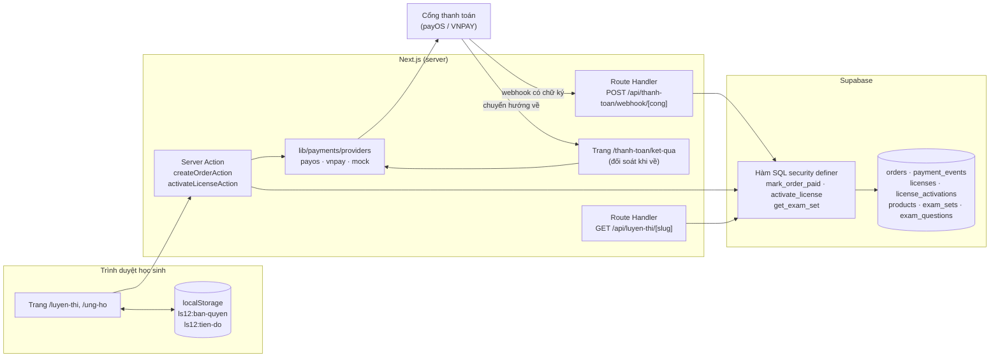
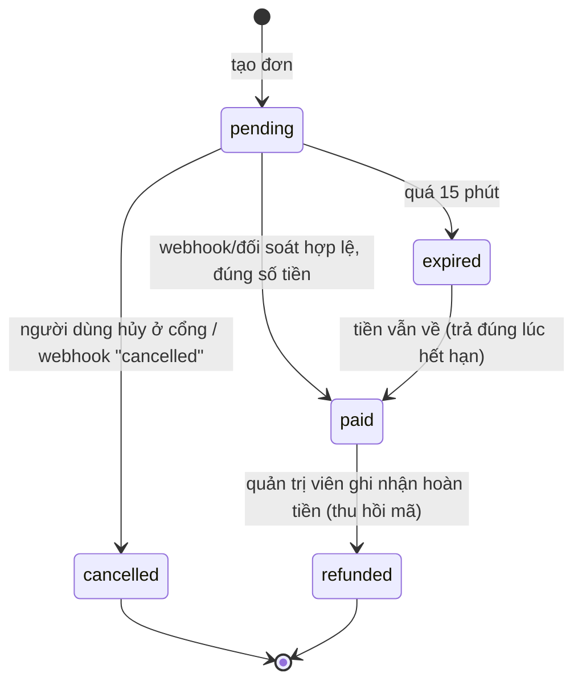

# Kế hoạch chức năng Thanh toán — Lịch sử Việt Nam 12

> Tài liệu đề xuất và kế hoạch triển khai chức năng thanh toán theo yêu cầu của giảng viên.
> Bám đúng kiến trúc hiện có của dự án: Next.js 16 (App Router, Server Action), Supabase (PostgreSQL + RLS),
> tiến độ học tập lưu trên trình duyệt (không có tài khoản học sinh).
>
> Ngày lập: 13/10/2026 · Nhánh: `fix/sua-loi-va-ke-hoach-thanh-toan`

---

## Mục lục

1. [Tóm tắt đề xuất](#1-tóm-tắt-đề-xuất)
2. [Các ý tưởng đã cân nhắc và cách chọn](#2-các-ý-tưởng-đã-cân-nhắc-và-cách-chọn)
3. [Mô tả sản phẩm: "Gói Luyện thi THPT" và "Ủng hộ dự án"](#3-mô-tả-sản-phẩm)
4. [Chọn cổng thanh toán](#4-chọn-cổng-thanh-toán)
5. [Kiến trúc tổng thể](#5-kiến-trúc-tổng-thể)
6. [Thiết kế cơ sở dữ liệu (migration)](#6-thiết-kế-cơ-sở-dữ-liệu)
7. [Luồng xử lý chi tiết](#7-luồng-xử-lý-chi-tiết)
8. [Danh sách tệp cần tạo / sửa](#8-danh-sách-tệp-cần-tạo--sửa)
9. [Giao diện người dùng](#9-giao-diện-người-dùng)
10. [Trang quản trị](#10-trang-quản-trị)
11. [Bảo mật — checklist bắt buộc](#11-bảo-mật--checklist-bắt-buộc)
12. [Kiểm thử](#12-kiểm-thử)
13. [Lộ trình triển khai theo giai đoạn](#13-lộ-trình-triển-khai)
14. [Kịch bản demo trước giảng viên](#14-kịch-bản-demo)
15. [Rủi ro, pháp lý và lưu ý](#15-rủi-ro-pháp-lý-và-lưu-ý)
16. [Phụ lục: biến môi trường, mã trạng thái, tài liệu tham khảo](#16-phụ-lục)

---

## 1. Tóm tắt đề xuất

**Nguyên tắc chọn:** web là công cụ học SGK cho học sinh, nên **toàn bộ nội dung SGK hiện có vẫn miễn phí**. Thanh
toán chỉ áp dụng cho phần **làm thêm, có giá trị riêng**, để không đi ngược mục tiêu giáo dục của đồ án.

**Đề xuất chính (khuyến nghị làm):**

| # | Chức năng | Loại thanh toán | Vì sao chọn |
|---|---|---|---|
| A | **Gói Luyện thi tốt nghiệp THPT môn Lịch sử** — các đề luyện 40 câu bấm giờ theo cấu trúc đề thi, có giải thích, chấm điểm, con dấu trong Hộ chiếu | Mua **một lần**, nhận **mã kích hoạt** | Đúng nhu cầu thật của học sinh lớp 12; tận dụng hệ thống trắc nghiệm + Hộ chiếu đã có; **không cần tài khoản học sinh** (mã kích hoạt hoạt động giống "mã tiến độ" đang có) |
| B | **Ủng hộ dự án** — tự chọn số tiền, có "Bức tường cảm ơn" | Thanh toán **tự nguyện** | Dùng chung toàn bộ đường ống thanh toán của A, làm thêm rất ít; thể hiện được luồng thanh toán ngay cả khi chưa có nội dung trả phí |

**Cổng thanh toán:** **payOS** (chuyển khoản VietQR, phí thấp, có SDK Node.js chính thức) là cổng chính; thêm một
**cổng giả lập (mock)** để phát triển, chạy E2E và demo không cần mạng; **VNPAY sandbox** là phương án dự phòng
(thanh toán bằng thẻ ATM test).

**Khối lượng ước tính:** khoảng **10–13 ngày công** cho một người, chia 6 giai đoạn (mục 13). Giai đoạn 1–3 (đủ để
demo luồng mua → trả tiền → kích hoạt) mất khoảng 6 ngày.

---

## 2. Các ý tưởng đã cân nhắc và cách chọn

Chấm theo 5 tiêu chí (1–5 điểm): **Phù hợp** với web học SGK · **Giá trị** thật cho người trả tiền · **Khả thi** với
kiến trúc hiện tại · **Ấn tượng khi demo** · **Đạo đức** (không khóa kiến thức cơ bản sau tường phí).

| Ý tưởng | Phù hợp | Giá trị | Khả thi | Demo | Đạo đức | Tổng | Kết luận |
|---|:-:|:-:|:-:|:-:|:-:|:-:|---|
| **A. Gói Luyện thi THPT (mã kích hoạt)** | 5 | 5 | 4 | 5 | 4 | **23** | ✅ Chọn làm chính |
| **B. Ủng hộ dự án + Bức tường cảm ơn** | 4 | 3 | 5 | 4 | 5 | **21** | ✅ Làm kèm (dùng chung hạ tầng) |
| C. Gói "Lớp học" cho giáo viên (tạo lớp, giao bài, xem điểm học sinh), trả theo năm học | 5 | 5 | 2 | 5 | 5 | 22 | ⏭ Hướng phát triển: cần tài khoản học sinh/giáo viên — gần như một đồ án mới |
| D. In "Hộ chiếu lịch sử" / giấy chứng nhận bản giấy, giao tận nhà | 3 | 3 | 2 | 3 | 5 | 16 | ❌ Cần quản lý vận chuyển, địa chỉ — lệch trọng tâm |
| E. Khóa nội dung SGK nâng cao (bản đồ 3D, phim 3D) sau tường phí | 3 | 3 | 5 | 3 | 1 | 15 | ❌ Khóa đúng phần làm nên giá trị của web; học sinh không mua được thì thiệt |
| F. Đặt vé tham quan di tích (Điện Biên Phủ, Dinh Độc Lập…) | 2 | 3 | 1 | 4 | 4 | 14 | ❌ Không có API vé thật; phải giả lập toàn bộ |
| G. Quảng cáo / tài trợ banner | 2 | 2 | 4 | 1 | 2 | 11 | ❌ Không phải "thanh toán" trên web, phản cảm với học sinh |

**Vì sao A + B là tốt nhất:**

- **Không phải xây hệ thống tài khoản học sinh.** Dự án đang cố ý không bắt học sinh đăng nhập (tiến độ lưu
  `localStorage`, chuyển máy bằng "mã tiến độ" `LS12-…`). Mã kích hoạt gói luyện thi đi đúng triết lý đó: mua →
  nhận mã `LT12-XXXX-XXXX-XXXX` → nhập trên máy nào cũng được (giới hạn số máy).
- **Tận dụng tối đa cái đã có:** trình chơi trắc nghiệm (`components/quiz/*`), tiến độ và con dấu
  (`lib/progress/progress.ts`, `components/progress/Passport.tsx`), quy trình biên tập → kiểm duyệt → công bố,
  RLS 4 vai trò, trang Vận hành.
- **Đủ "chất" kỹ thuật để chấm điểm:** webhook có xác thực chữ ký, xử lý idempotent, đối soát, máy trạng thái đơn
  hàng, RLS cho dữ liệu nhạy cảm, kiểm thử E2E toàn luồng.
- **Không làm hại người học:** 17 bài SGK, bản đồ, 3D, trắc nghiệm theo bài **giữ nguyên miễn phí**.

---

## 3. Mô tả sản phẩm

### 3.1. Gói Luyện thi THPT môn Lịch sử (sản phẩm A)

| Thuộc tính | Giá trị đề xuất |
|---|---|
| Tên | Gói Luyện thi tốt nghiệp THPT – Lịch sử (năm học 2026–2027) |
| Giá | **29.000đ**, mua một lần, dùng hết năm học (hết hạn 31/7/2027) |
| Nội dung | 10 đề luyện × 40 câu, bấm giờ 50 phút, chấm điểm thang 10, giải thích từng câu kèm liên kết về Bài SGK/sự kiện liên quan; thống kê điểm yếu theo bài |
| Cách nhận | Mã kích hoạt `LT12-XXXX-XXXX-XXXX` hiện ngay sau khi thanh toán (và gửi email nếu bật giai đoạn 6) |
| Giới hạn | Mỗi mã kích hoạt được trên **3 thiết bị** |
| Quyền lợi phụ | Con dấu "Luyện thi" trong Hộ chiếu lịch sử khi đạt ≥ 7 điểm ở một đề |
| Dùng thử | Đề số 1 **miễn phí** để học sinh biết mình mua gì |

**Nguồn câu hỏi:** tự soạn theo cấu trúc đề minh họa công khai của Bộ GD&ĐT, đi qua đúng quy trình biên tập → kiểm
duyệt hiện có (câu hỏi phải có nguồn, như sự kiện). Không sao chép đề của sách/website thương mại.

### 3.2. Ủng hộ dự án (sản phẩm B)

| Thuộc tính | Giá trị đề xuất |
|---|---|
| Số tiền | Chọn nhanh 10.000 / 20.000 / 50.000đ, hoặc tự nhập 10.000–2.000.000đ |
| Thông tin | Tên hiển thị (không bắt buộc), lời nhắn ≤ 200 ký tự (không bắt buộc), ô "Hiện trên Bức tường cảm ơn" (**mặc định tắt**) |
| Bức tường cảm ơn | Chỉ hiện tên + lời nhắn **đã được quản trị viên duyệt**; không bao giờ hiện email, số tiền chính xác chỉ hiện theo khoảng |

---

## 4. Chọn cổng thanh toán

| | **payOS** (khuyến nghị) | **VNPAY** (dự phòng) | **MoMo** | **Cổng giả lập (mock)** |
|---|---|---|---|---|
| Hình thức | Chuyển khoản qua mã VietQR, mọi app ngân hàng | Thẻ ATM nội địa, thẻ quốc tế, QR | Ví MoMo | Trang giả lập trong chính web |
| Môi trường thử | Có trang "Môi trường test" | Sandbox công khai `sandbox.vnpayment.vn`, có thẻ test | Có môi trường test | Luôn có, không cần mạng |
| SDK Node | `@payos/node` (chính thức) | Thư viện cộng đồng `vnpay` | Tự gọi REST + ký HMAC | Tự viết (~100 dòng) |
| Nhận kết quả | Webhook có chữ ký (checksum key) | IPN có `vnp_SecureHash` + Return URL | IPN có chữ ký | Webhook giả lập ký HMAC |
| Dùng khi | Production / demo thật bằng điện thoại | Muốn demo thanh toán thẻ | (Không ưu tiên) | Phát triển, E2E, demo không có mạng |

**Lý do chọn payOS:** học sinh lớp 12 thường không có thẻ, nhưng hầu như ai cũng có (hoặc phụ huynh có) app ngân
hàng để quét VietQR. SDK chính thức gọn: tạo link thanh toán bằng `paymentRequests.create(...)` và xác thực webhook
bằng `webhooks.verify(...)`.

> ⚠️ **Phải kiểm tra lại trên tài liệu chính thức trước khi code:** điều kiện đăng ký kênh thanh toán (cá nhân hay
> doanh nghiệp), giới hạn của `orderCode` (số nguyên, duy nhất) và **độ dài tối đa của `description`** (rất ngắn — giữ
> ≤ 25 ký tự cho chắc, ví dụ `LT12 DH123456`), cách bật môi trường test. Plan này đóng gói cổng thanh toán sau
> một interface chung nên đổi cổng không ảnh hưởng phần còn lại.

**Thiết kế đa cổng:** mọi cổng cài đặt chung interface `PaymentProvider` (mục 5.3). Chọn cổng bằng biến môi trường
`PAYMENT_PROVIDER=payos | vnpay | mock`.

---

## 5. Kiến trúc tổng thể

### 5.1. Sơ đồ thành phần



### 5.2. Quyết định kiến trúc quan trọng

1. **Số tiền luôn do server quyết định** từ bảng `products` — form chỉ gửi `product_slug` (và số tiền ủng hộ, được
   kiểm tra khoảng ở server). Không bao giờ tin số tiền từ trình duyệt.
2. **Webhook là nguồn sự thật**, trang "kết quả" chỉ để hiển thị. Nếu webhook đến muộn (hoặc chạy `localhost` nơi
   cổng không gọi tới được), trang kết quả **chủ động hỏi lại cổng** (`getStatus`) rồi gọi cùng hàm `mark_order_paid`.
3. **Mọi thay đổi trạng thái đơn đi qua một hàm SQL duy nhất** `mark_order_paid(...)` chạy trong một giao dịch:
   kiểm tra số tiền khớp, chỉ chuyển `pending → paid` một lần, cấp mã kích hoạt. Gọi lặp lại vô hại (idempotent).
4. **Bảng thanh toán không mở cho khách:** RLS chặn hoàn toàn `anon`; server ghi bằng khóa bí mật
   (`lib/supabase/admin.ts`, đã có `import "server-only"`); quản trị viên chỉ **đọc** qua phiên của mình.
5. **Không lưu dữ liệu thẻ/ngân hàng** — việc nhập thẻ, quét QR diễn ra ở trang của cổng thanh toán.
6. **Không cần tài khoản học sinh:** quyền dùng gói = mã kích hoạt + mã thiết bị ngẫu nhiên lưu `localStorage`.

### 5.3. Interface cổng thanh toán

```ts
// lib/payments/types.ts
export type ProviderName = "payos" | "vnpay" | "mock";

export type CheckoutInput = {
  orderCode: number;          // số đơn duy nhất (bigint trong DB, < 2^53)
  amountVnd: number;          // số nguyên VND, do server tính
  description: string;        // ≤ 25 ký tự, không dấu
  itemName: string;
  returnUrl: string;          // https://…/thanh-toan/ket-qua?don=<orderCode>
  cancelUrl: string;          // https://…/thanh-toan/ket-qua?don=<orderCode>&huy=1
  expiresAt: Date;            // 15 phút
  buyerIp: string;            // VNPAY bắt buộc
};

export type CheckoutResult = { checkoutUrl: string; providerRef: string | null };

/** Kết quả đã XÁC THỰC chữ ký — chỉ hàm verify mới tạo ra được kiểu này. */
export type VerifiedPayment = {
  orderCode: number;
  amountVnd: number;
  status: "paid" | "cancelled" | "failed";
  providerRef: string;        // mã giao dịch phía cổng
  raw: unknown;               // để lưu payment_events
};

export interface PaymentProvider {
  readonly name: ProviderName;
  createCheckout(input: CheckoutInput): Promise<CheckoutResult>;
  /** Trả null nếu chữ ký sai / dữ liệu hỏng. KHÔNG được ném lỗi ra ngoài route handler. */
  verifyWebhook(request: Request): Promise<VerifiedPayment | null>;
  /** Hỏi lại cổng trạng thái thật của đơn (đối soát). */
  getStatus(orderCode: number): Promise<VerifiedPayment | { status: "pending" }>;
  cancel?(orderCode: number, reason: string): Promise<void>;
  /** Phản hồi webhook đúng định dạng cổng mong đợi (VNPAY cần JSON RspCode). */
  webhookResponse(ok: boolean, reason?: string): Response;
}
```

---

## 6. Thiết kế cơ sở dữ liệu

Migration mới: `supabase/migrations/20261015000000_payments.sql` (một giao dịch `begin; … commit;`, theo đúng
phong cách các migration hiện có).

### 6.1. Bảng

```sql
begin;

-- Trạng thái đơn hàng (máy trạng thái ở mục 7.4)
create type public.order_status as enum ('pending', 'paid', 'cancelled', 'expired', 'refunded');
create type public.product_kind  as enum ('exam_pack', 'donation');

-- Sản phẩm bán. Giá ở đây là NGUỒN DUY NHẤT; form không gửi giá.
create table public.products (
  id           uuid primary key default gen_random_uuid(),
  slug         text not null unique check (slug ~ '^[a-z0-9-]+$'),
  kind         public.product_kind not null,
  name         text not null,
  price_vnd    integer check (price_vnd is null or price_vnd between 1000 and 10000000), -- null với ủng hộ
  min_vnd      integer,               -- chỉ cho ủng hộ
  max_vnd      integer,
  max_devices  smallint not null default 3,
  valid_until  timestamptz,           -- hạn dùng của mã (gói luyện thi theo năm học)
  is_active    boolean not null default true,
  created_at   timestamptz not null default now(),
  updated_at   timestamptz not null default now(),
  constraint products_price_rule check (
    (kind = 'exam_pack' and price_vnd is not null) or
    (kind = 'donation'  and min_vnd is not null and max_vnd is not null and min_vnd <= max_vnd)
  )
);

create sequence public.order_code_seq start 100001;

create table public.orders (
  id               uuid primary key default gen_random_uuid(),
  order_code       bigint not null unique default nextval('public.order_code_seq'),
  product_id       uuid not null references public.products(id),
  amount_vnd       integer not null check (amount_vnd > 0),
  provider         text not null check (provider in ('payos', 'vnpay', 'mock')),
  provider_ref     text,                         -- mã giao dịch phía cổng (khi đã trả)
  checkout_url     text,
  status           public.order_status not null default 'pending',
  buyer_email      text check (buyer_email is null or buyer_email ~* '^[^@\s]+@[^@\s]+\.[^@\s]+$'),
  display_name     text check (char_length(display_name) <= 60),
  message          text check (char_length(message) <= 200),
  show_on_wall     boolean not null default false,
  wall_approved    boolean not null default false, -- quản trị viên duyệt lời nhắn
  access_token_hash text not null,               -- sha256 của token trong cookie người mua (xem đơn của mình)
  client_ip_hash   text,                         -- sha256(ip + salt) để chống spam, không lưu IP thô
  expires_at       timestamptz not null default now() + interval '15 minutes',
  paid_at          timestamptz,
  created_at       timestamptz not null default now(),
  updated_at       timestamptz not null default now(),
  constraint orders_paid_has_time check (status <> 'paid' or paid_at is not null)
);
create index idx_orders_status_created on public.orders (status, created_at desc);
create index idx_orders_ip_recent      on public.orders (client_ip_hash, created_at desc);

-- Nhật ký mọi webhook/đối soát nhận được (kể cả chữ ký sai) — phục vụ điều tra, đối soát, chấm điểm.
create table public.payment_events (
  id            bigint generated always as identity primary key,
  order_code    bigint,                            -- có thể null nếu payload hỏng
  provider      text not null,
  source        text not null check (source in ('webhook', 'return', 'reconcile', 'admin')),
  signature_ok  boolean not null,
  status        text,
  amount_vnd    integer,
  provider_ref  text,
  payload       jsonb not null,
  note          text,
  received_at   timestamptz not null default now()
);
create index idx_payment_events_order on public.payment_events (order_code, received_at desc);
-- Chống xử lý trùng một giao dịch của cổng
create unique index uq_payment_events_ref on public.payment_events (provider, provider_ref, source)
  where provider_ref is not null and signature_ok;

-- Mã kích hoạt (chỉ với exam_pack)
create table public.licenses (
  id           uuid primary key default gen_random_uuid(),
  order_id     uuid not null unique references public.orders(id),
  product_id   uuid not null references public.products(id),
  code         text not null unique check (code ~ '^LT12-[A-HJ-NP-Z2-9]{4}-[A-HJ-NP-Z2-9]{4}-[A-HJ-NP-Z2-9]{4}$'),
  status       text not null default 'active' check (status in ('active', 'revoked')),
  max_devices  smallint not null,
  valid_until  timestamptz,
  created_at   timestamptz not null default now()
);

create table public.license_activations (
  license_id     uuid not null references public.licenses(id) on delete cascade,
  device_hash    text not null,                 -- sha256(device_id) — device_id là UUID ngẫu nhiên trong localStorage
  activated_at   timestamptz not null default now(),
  last_seen_at   timestamptz not null default now(),
  primary key (license_id, device_hash)
);

-- Nội dung gói luyện thi: đi theo quy trình biên tập → kiểm duyệt như nội dung khác
create table public.exam_sets (
  id               uuid primary key default gen_random_uuid(),
  slug             text not null unique,
  title            text not null,
  product_id       uuid references public.products(id),  -- null = miễn phí (đề dùng thử)
  duration_min     smallint not null default 50,
  sort_order       integer not null default 0,
  workflow_status  public.workflow_status not null default 'draft',
  created_at       timestamptz not null default now(),
  updated_at       timestamptz not null default now()
);

create table public.exam_questions (
  id            uuid primary key default gen_random_uuid(),
  set_id        uuid not null references public.exam_sets(id) on delete cascade,
  position      smallint not null,
  prompt        text not null,
  choices       jsonb not null check (jsonb_typeof(choices) = 'array' and jsonb_array_length(choices) = 4),
  answer_index  smallint not null check (answer_index between 0 and 3),
  explanation   text not null,
  lesson_slug   text,                         -- liên kết về Bài SGK để "đọc lại"
  event_id      uuid references public.historical_events(id) on delete set null,
  source_note   text not null,
  unique (set_id, position)
);

-- updated_at dùng lại trigger set_updated_at() đã có
create trigger trg_products_updated_at  before update on public.products  for each row execute function public.set_updated_at();
create trigger trg_orders_updated_at    before update on public.orders    for each row execute function public.set_updated_at();
create trigger trg_exam_sets_updated_at before update on public.exam_sets for each row execute function public.set_updated_at();
```

### 6.2. RLS

```sql
alter table public.products            enable row level security;
alter table public.orders              enable row level security;
alter table public.payment_events      enable row level security;
alter table public.licenses            enable row level security;
alter table public.license_activations enable row level security;
alter table public.exam_sets           enable row level security;
alter table public.exam_questions      enable row level security;

-- Khách xem được sản phẩm đang bán (để hiện giá)
create policy "public_read_active" on public.products for select to anon, authenticated using (is_active);
create policy "admin_manage"       on public.products for all to authenticated
  using (public.current_staff_role() = 'system_admin') with check (public.current_staff_role() = 'system_admin');

-- Đơn hàng / nhật ký / mã: KHÁCH KHÔNG CÓ QUYỀN GÌ. Server ghi bằng khóa bí mật. Admin chỉ đọc.
create policy "admin_read" on public.orders              for select to authenticated using (public.current_staff_role() = 'system_admin');
create policy "admin_read" on public.payment_events      for select to authenticated using (public.current_staff_role() = 'system_admin');
create policy "admin_read" on public.licenses            for select to authenticated using (public.current_staff_role() = 'system_admin');
create policy "admin_read" on public.license_activations for select to authenticated using (public.current_staff_role() = 'system_admin');
-- Duyệt lời nhắn ủng hộ: chỉ cho sửa đúng cột wall_approved (kiểm bằng trigger, như reviewer_status_only)

-- Đề luyện thi: khách chỉ thấy DANH SÁCH đề đã công bố (tiêu đề, số câu), KHÔNG đọc trực tiếp câu hỏi.
create policy "public_read_published" on public.exam_sets for select to anon, authenticated using (workflow_status = 'published');
-- exam_questions: không có policy select cho anon → câu hỏi chỉ lấy qua hàm get_exam_set() bên dưới.
-- Nhân sự: dùng lại mẫu policy của quiz_questions (editor sửa khi draft/needs_revision, reviewer đổi trạng thái, admin toàn quyền).

-- Bức tường cảm ơn: view chỉ lộ cột an toàn
create view public.donation_wall with (security_invoker = false) as
  select display_name, message, paid_at,
         case when amount_vnd < 50000 then 'Ủng hộ' when amount_vnd < 200000 then 'Ủng hộ nhiệt tình' else 'Nhà hảo tâm' end as tier
  from public.orders o join public.products p on p.id = o.product_id
  where p.kind = 'donation' and o.status = 'paid' and o.show_on_wall and o.wall_approved;
grant select on public.donation_wall to anon, authenticated;
```

### 6.3. Hàm SQL (security definer, `set search_path = ''` như `current_staff_role()`)

| Hàm | Ai gọi | Việc làm |
|---|---|---|
| `mark_order_paid(p_order_code bigint, p_amount int, p_provider text, p_provider_ref text) returns jsonb` | Server (khóa bí mật) sau khi đã xác thực chữ ký | Khóa dòng (`for update`); nếu `status='paid'` → trả `{ok:true, already:true}`; nếu `status` không phải `pending`/`expired` → từ chối; nếu `amount` ≠ `amount_vnd` → từ chối và ghi `payment_events.note='amount_mismatch'`; ngược lại chuyển `paid`, đặt `paid_at`, `provider_ref`; nếu sản phẩm là `exam_pack` thì sinh mã `LT12-…` (thử lại khi trùng) và chèn `licenses`. |
| `activate_license(p_code text, p_device_hash text) returns jsonb` | Server Action `activateLicenseAction` | Chuẩn hóa mã (in hoa, bỏ khoảng trắng); kiểm tra `active`, chưa hết hạn; nếu thiết bị đã kích hoạt → cập nhật `last_seen_at`; nếu số thiết bị < `max_devices` → thêm; ngược lại trả `{ok:false, reason:'device_limit'}`. |
| `get_exam_set(p_slug text, p_code text, p_device_hash text) returns jsonb` | Route `GET /api/luyen-thi/[slug]` | Đề miễn phí → trả luôn; đề trả phí → kiểm tra mã + thiết bị đã kích hoạt, rồi trả câu hỏi. |
| `expire_stale_orders() returns int` | Gọi "lười" khi tạo đơn mới, hoặc `pg_cron` mỗi 10 phút | `pending` quá `expires_at` → `expired`. |

> Lưu ý: `mark_order_paid` chấp nhận cả đơn `expired` — người dùng có thể trả tiền đúng lúc link vừa hết hạn; tiền đã
> vào thì phải cấp quyền, không được "nuốt" tiền.

### 6.4. Dữ liệu ban đầu

`supabase/seed-payments.sql`: 2 sản phẩm (`goi-luyen-thi-2027` giá 29.000đ, hạn 31/7/2027; `ung-ho` 10.000–2.000.000đ),
đề `de-1` miễn phí + `de-2`…`de-10` gắn với gói. Cập nhật `lib/database.types.ts` bằng `supabase gen types`.

---

## 7. Luồng xử lý chi tiết

### 7.1. Mua gói luyện thi (luồng chính)

```mermaid
sequenceDiagram
  autonumber
  actor HS as Học sinh
  participant W as Web (Next.js)
  participant DB as Supabase
  participant G as Cổng thanh toán

  HS->>W: Bấm "Mua gói 29.000đ" (+ email, tùy chọn)
  W->>W: createOrderAction: kiểm tra form (zod), chống spam theo IP
  W->>DB: insert orders (amount lấy từ products, status=pending)
  W->>G: createCheckout(orderCode, amount, returnUrl, cancelUrl)
  G-->>W: checkoutUrl
  W->>W: Đặt cookie httpOnly ls12_don = <orderCode>.<token>
  W-->>HS: redirect(checkoutUrl)
  HS->>G: Quét VietQR / nhập thẻ test
  par Cổng báo kết quả
    G->>W: POST /api/thanh-toan/webhook/payos (có chữ ký)
    W->>W: verifyWebhook → sai chữ ký? ghi event, trả 400
    W->>DB: insert payment_events; rpc mark_order_paid()
    DB-->>W: {ok, license_code}
    W-->>G: 200 OK
  and Người dùng quay về
    G-->>HS: redirect /thanh-toan/ket-qua?don=…
    HS->>W: GET /thanh-toan/ket-qua
    W->>DB: đọc đơn (đối chiếu token trong cookie)
    alt vẫn pending
      W->>G: getStatus(orderCode)  (đối soát)
      W->>DB: rpc mark_order_paid() nếu đã trả
    end
    W-->>HS: "Thanh toán thành công" + mã LT12-XXXX-XXXX-XXXX + nút "Kích hoạt trên máy này"
  end
  HS->>W: Kích hoạt → activateLicenseAction(code, deviceId)
  W->>DB: rpc activate_license()
  W-->>HS: Lưu mã vào localStorage, mở khóa 10 đề
```

### 7.2. Làm đề luyện thi

1. `/luyen-thi` (Server Component) liệt kê đề đã công bố từ `exam_sets` — đề khóa hiện biểu tượng ổ khóa.
2. Mở `/luyen-thi/de-3` → Client Component đọc mã + `device_id` từ `localStorage` → gọi
   `GET /api/luyen-thi/de-3` với header `X-License-Code`, `X-Device-Id`.
3. Route handler băm `device_id`, gọi `get_exam_set` → trả câu hỏi (header `Cache-Control: private, no-store`).
4. Làm bài với trình chơi trắc nghiệm hiện có (thêm chế độ bấm giờ); kết thúc → `saveQuizResult("luyen-thi:de-3", …)`
   → tiến độ và **con dấu** trong Hộ chiếu tự hoạt động nhờ `buildStampCatalog` (thêm nhóm "luyện thi").

> Mức bảo vệ phù hợp đồ án: người đã có quyền vẫn có thể chép câu hỏi — chấp nhận được. Điều quan trọng là **không có
> quyền thì không lấy được** (RLS + hàm kiểm tra), và mã bị chia sẻ rộng thì giới hạn 3 thiết bị chặn lại, quản trị viên
> có thể thu hồi.

### 7.3. Ủng hộ

Giống 7.1 nhưng: số tiền do người dùng chọn (server kiểm tra trong `[min_vnd, max_vnd]`), **không sinh mã**, trang kết
quả hiện lời cảm ơn; nếu tích "Hiện trên Bức tường", lời nhắn vào hàng chờ duyệt ở trang quản trị.

### 7.4. Máy trạng thái đơn hàng



Mọi chuyển trạng thái khác bị hàm SQL từ chối. Có unit test cho bảng chuyển trạng thái (giống `REVIEW_TRANSITIONS`
trong `lib/admin/review.ts`).

### 7.5. Các tình huống lỗi phải xử lý

| Tình huống | Cách xử lý |
|---|---|
| Webhook gửi lại nhiều lần | `mark_order_paid` idempotent; unique index trên `payment_events` |
| Chữ ký sai / payload giả | Ghi `payment_events(signature_ok=false)`, trả 400, **không** đổi trạng thái |
| Số tiền nhận ≠ số tiền đơn | Không cấp quyền; đánh dấu để quản trị viên xử lý; hiện cảnh báo ở trang Đơn hàng |
| Người dùng đóng tab trước khi quay về | Webhook vẫn cập nhật; người dùng tra cứu lại mã tại `/thanh-toan/tra-cuu` (email + mã đơn) |
| Chạy localhost, cổng không gọi được webhook | Trang kết quả đối soát bằng `getStatus` |
| Cổng thanh toán sập khi tạo đơn | Đơn chuyển `cancelled`, báo lỗi tiếng Việt, cho thử lại |
| Spam tạo đơn | Tối đa 5 đơn `pending` / IP / 10 phút (đếm theo `client_ip_hash`) |
| `localStorage` bị chặn (máy trường) | Vẫn kích hoạt được trong phiên; báo "máy này không lưu được mã, hãy giữ mã để nhập lại" |
| Hết 3 thiết bị | Thông báo rõ; quản trị viên có nút "Gỡ thiết bị cũ" |

---

## 8. Danh sách tệp cần tạo / sửa

### 8.1. Tạo mới

```
supabase/migrations/20261015000000_payments.sql      bảng, RLS, hàm SQL (mục 6)
supabase/seed-payments.sql                           sản phẩm + đề mẫu
supabase/tests/payments.sql                          kiểm thử ràng buộc + hàm (tự hoàn tác như constraints.sql)

lib/payments/types.ts                                PaymentProvider, VerifiedPayment… (mục 5.3)
lib/payments/config.ts                               đọc env, chọn cổng, "server-only"
lib/payments/providers/payos.ts                      dùng @payos/node
lib/payments/providers/vnpay.ts                      (giai đoạn 5) ký/kiểm HMAC-SHA512
lib/payments/providers/mock.ts                       cổng giả lập ký HMAC-SHA256, chặn ở production
lib/payments/pricing.ts                              hàm thuần: tính tiền, kiểm khoảng ủng hộ, mô tả ≤ 25 ký tự
lib/payments/order-status.ts                         bảng chuyển trạng thái + nhãn tiếng Việt
lib/payments/license.ts                              hàm thuần: sinh/chuẩn hóa/kiểm định dạng mã LT12-…
lib/payments/orders.ts                               server-only: tạo đơn, đối soát (dùng createAdminClient)
lib/actions/payments.ts                              "use server": createOrderAction, activateLicenseAction, lookupOrderAction
lib/actions/admin-payments.ts                        "use server": đối soát tay, thu hồi mã, gỡ thiết bị, duyệt lời nhắn, ghi nhận hoàn tiền
lib/validation/payments.ts                           zod schema cho form mua/ủng hộ/kích hoạt
lib/hooks/useLicense.ts                              đọc/ghi ls12:ban-quyen + device_id (mẫu như useProgress.ts)
lib/queries/payments.ts                              danh sách đề, bức tường cảm ơn (anon)
lib/queries/admin-payments.ts                        danh sách đơn, thống kê doanh thu (phiên admin)

app/api/thanh-toan/webhook/[cong]/route.ts           POST webhook (payos | vnpay | mock)
app/api/luyen-thi/[slug]/route.ts                    GET câu hỏi đề (kiểm mã)
app/(public)/luyen-thi/page.tsx                      trang giới thiệu + danh sách đề + nút mua
app/(public)/luyen-thi/[slug]/page.tsx               trang làm đề
app/(public)/ung-ho/page.tsx                         form ủng hộ + bức tường cảm ơn
app/(public)/thanh-toan/ket-qua/page.tsx             kết quả + đối soát + hiện mã
app/(public)/thanh-toan/tra-cuu/page.tsx             tra cứu đơn bằng email + mã đơn
app/(public)/thanh-toan/gia-lap/page.tsx             trang "ngân hàng giả lập" (chỉ khi PAYMENT_PROVIDER=mock)
app/(public)/kich-hoat/page.tsx                      nhập mã kích hoạt
app/quan-tri/(noi-bo)/don-hang/page.tsx              danh sách đơn, lọc, thống kê
app/quan-tri/(noi-bo)/don-hang/[ma]/page.tsx         chi tiết đơn + nhật ký sự kiện + thao tác
app/quan-tri/(noi-bo)/de-luyen-thi/…                 soạn đề (tái dùng khuôn form nội dung + kiểm duyệt)

components/payments/BuyPackCard.tsx                  thẻ giá + nút mua
components/payments/DonationForm.tsx                 chọn mức tiền nhanh / tự nhập
components/payments/LicenseCodeBox.tsx               hiện mã, nút chép, nút kích hoạt
components/payments/PaymentStatus.tsx                trạng thái đơn (đang chờ / thành công / hủy / hết hạn)
components/payments/DonationWall.tsx
components/payments/LockedBadge.tsx
components/quiz/ExamTimer.tsx                        đồng hồ đếm ngược cho đề luyện thi
components/admin/payments/OrderTable.tsx, OrderEvents.tsx, RevenueSummary.tsx

tests/unit/payments-pricing.test.ts
tests/unit/payments-license.test.ts
tests/unit/payments-status.test.ts
tests/unit/payments-providers.test.ts                kiểm chữ ký bằng payload mẫu (fixtures)
tests/e2e/payments.spec.ts                           toàn luồng với PAYMENT_PROVIDER=mock
tests/rls/payments.mjs                               anon không đọc được orders/licenses/exam_questions…
```

### 8.2. Sửa

| Tệp | Thay đổi |
|---|---|
| `package.json` | thêm `@payos/node` (và `vnpay` ở giai đoạn 5) |
| `.env.example`, `README.md` | biến môi trường mới (mục 16.1), hướng dẫn chạy migration/seed thanh toán |
| `proxy.ts` | loại `/api/thanh-toan/webhook` khỏi `matcher` (webhook không cần làm mới phiên, đỡ một lượt gọi Auth) |
| `components/layout/nav.ts` | thêm "Luyện thi THPT" vào nhóm **Ôn tập**; "Ủng hộ" ở chân trang |
| `components/admin/menu.ts` | mục "Đơn hàng" (icon `Receipt`, chỉ `system_admin`) và "Đề luyện thi" (`editor`, `reviewer`, `system_admin`) |
| `lib/quiz/sets.ts` | `quizSetIds.exam(slug) = "luyen-thi:" + slug`, `quizPaths.exam` |
| `lib/progress/progress.ts` | `buildStampCatalog` nhận thêm danh sách đề luyện thi (kind `"exam"`) |
| `lib/admin/operations.ts` + trang Vận hành | kiểm tra cấu hình cổng thanh toán, số đơn lệch tiền, webhook lỗi 24 giờ qua |
| `app/sitemap.ts` | thêm `/luyen-thi`, `/ung-ho` |
| `docs/test-report.md` | kết quả kiểm thử thanh toán |

---

## 9. Giao diện người dùng

Theo đúng hệ giao diện "SGK số" hiện có (`docs/huong-dan-giao-dien.md`): font Lora/Be Vietnam Pro, màu vàng
`gold`, thẻ `rounded-card`, nhãn tiếng Việt thân thiện, chế độ sáng/tối.

**`/luyen-thi`**
- Đầu trang: tiêu đề, 3 lợi ích ngắn, giá **29.000đ – dùng đến 31/7/2027**, nút "Làm thử đề 1 miễn phí" và "Mua gói".
- Lưới 10 đề: đề đã làm hiện điểm cao nhất (từ `useProgress`), đề khóa hiện ổ khóa.
- Đã kích hoạt → thay khối giá bằng "Gói đã kích hoạt trên máy này · còn N/3 thiết bị".

**Hộp mua (modal hoặc trang con)**
- Email (không bắt buộc, giải thích: "để tra cứu lại mã nếu em làm mất"); ô đồng ý điều khoản;
  ghi chú "Nếu em dưới 18 tuổi, hãy hỏi ý kiến bố mẹ trước khi thanh toán".
- Nút "Thanh toán 29.000đ" → chuyển sang trang cổng thanh toán.

**`/thanh-toan/ket-qua`**
- `pending`: vòng xoay + "Đang xác nhận thanh toán…" (tự làm mới 3 giây/lần, tối đa 2 phút, rồi gợi ý tra cứu).
- `paid` (gói): mã `LT12-…` cỡ lớn, nút **Chép mã**, nút **Kích hoạt trên máy này**, cảnh báo "hãy lưu mã lại".
- `paid` (ủng hộ): lời cảm ơn + trạng thái duyệt lời nhắn.
- `cancelled` / `expired`: giải thích + nút "Thử lại".

**`/kich-hoat`**: ô nhập mã (tự in hoa, tự thêm gạch), thông báo lỗi rõ ràng cho từng trường hợp
(sai mã / đã thu hồi / hết hạn / quá số thiết bị).

**Khả năng truy cập:** dùng lại `Button`, `Input`, `Callout`; thông báo trạng thái `role="status"`; thêm trang mới vào
`tests/e2e/a11y.spec.ts` (axe-core).

---

## 10. Trang quản trị

**Đơn hàng** (`/quan-tri/don-hang`, chỉ `system_admin`)
- Thẻ thống kê: doanh thu hôm nay / 7 ngày / 30 ngày, số đơn theo trạng thái, số mã đang hoạt động.
- Bảng đơn: mã đơn, thời gian, sản phẩm, số tiền, cổng, trạng thái (badge màu như `StatusBadge`), lọc theo trạng thái
  và khoảng ngày, tìm theo mã đơn / email.
- Chi tiết đơn: thông tin đơn, **nhật ký `payment_events`** (kể cả chữ ký sai), mã kích hoạt + danh sách thiết bị.
- Thao tác (Server Action, `requireRole(["system_admin"])` ở đầu, ghi `payment_events(source='admin')`):
  **Đối soát với cổng** · **Thu hồi mã** · **Gỡ một thiết bị** · **Ghi nhận đã hoàn tiền** (hoàn tiền thực hiện ngoài
  hệ thống, ở cổng/ngân hàng) · **Duyệt / ẩn lời nhắn ủng hộ**.

**Đề luyện thi** (`/quan-tri/de-luyen-thi`)
- Tái dùng khuôn `QuizQuestionManager` + quy trình **biên tập → gửi duyệt → công bố** đã có.
- Kiểm tra trước khi gửi duyệt (mở rộng `lib/admin/readiness.ts`): đủ 40 câu, mỗi câu có giải thích và nguồn,
  đáp án đúng nằm trong 4 lựa chọn.

---

## 11. Bảo mật — checklist bắt buộc

- [ ] Số tiền tính ở server từ `products`; zod kiểm số tiền ủng hộ là số nguyên trong khoảng cho phép.
- [ ] Mọi webhook xác thực chữ ký **trước** khi đọc dữ liệu; so sánh chữ ký bằng `crypto.timingSafeEqual`.
- [ ] Đối chiếu `amount` của cổng với `amount_vnd` của đơn trong hàm SQL (trong cùng giao dịch, `for update`).
- [ ] Idempotent: webhook lặp, đối soát lặp, bấm F5 trang kết quả đều không cấp mã hai lần.
- [ ] Khóa cổng thanh toán và `SUPABASE_SECRET_KEY` chỉ ở server: module có `import "server-only"`, không có tiền tố
      `NEXT_PUBLIC_`; không ghi khóa/chữ ký vào log.
- [ ] RLS: `anon` không `select` được `orders`, `payment_events`, `licenses`, `license_activations`,
      `exam_questions` — có kiểm thử tự động (`tests/rls/payments.mjs`).
- [ ] Hàm `security definer` đặt `set search_path = ''`, chỉ `grant execute` cho vai trò cần thiết
      (`mark_order_paid`: chỉ `service_role`).
- [ ] Cổng giả lập (`mock`) **từ chối chạy** khi `NODE_ENV=production` hoặc thiếu `MOCK_PAYMENT_SECRET`.
- [ ] Cookie xem đơn: `httpOnly`, `secure`, `sameSite=lax`, chỉ chứa `orderCode.token`; DB chỉ lưu `sha256(token)`.
- [ ] Trang kết quả chỉ hiện mã khi token trong cookie khớp (không ai đoán `?don=100123` để lấy mã của người khác).
- [ ] Tra cứu bằng email + mã đơn: giới hạn số lần thử theo IP.
- [ ] `returnUrl` / `cancelUrl` dựng từ `siteUrl()` (lib/site.ts), không lấy từ request → không bị chuyển hướng mở.
- [ ] Không lưu IP thô (chỉ băm có salt); không lưu dữ liệu thẻ; email chỉ dùng để tra cứu mã.
- [ ] Lời nhắn ủng hộ hiển thị dạng văn bản thuần (React tự escape), phải được duyệt mới lên bức tường.
- [ ] Header `Cache-Control: private, no-store` cho route trả câu hỏi và trang kết quả.

---

## 12. Kiểm thử

| Loại | Nội dung chính | Công cụ |
|---|---|---|
| Unit | Tính tiền, khoảng ủng hộ, mô tả ≤ 25 ký tự không dấu; định dạng/chuẩn hóa mã `LT12-…` (bỏ ký tự dễ nhầm O/0, I/1); bảng chuyển trạng thái; xác thực chữ ký payOS/VNPAY/mock với payload mẫu đúng và bị sửa 1 ký tự; `buildStampCatalog` có nhóm luyện thi | Vitest (`tests/unit`) |
| CSDL | `mark_order_paid` gọi 2 lần chỉ tạo 1 mã; sai số tiền bị từ chối; `expired → paid` được; `paid → pending` bị chặn; `activate_license` dừng ở thiết bị thứ 4 | `supabase/tests/payments.sql` (tự `rollback`) |
| RLS | `anon` / `editor` / `reviewer` không đọc được đơn & mã; `system_admin` đọc được; `anon` không đọc được `exam_questions` trực tiếp | `tests/rls/payments.mjs` |
| E2E | (1) Mua gói → giả lập trả tiền → thấy mã → kích hoạt → mở đề 2; (2) Hủy ở cổng → trang báo hủy; (3) Gửi lại webhook → không tạo mã thứ hai; (4) Webhook sửa số tiền → bị từ chối; (5) Ủng hộ + duyệt lời nhắn → hiện trên bức tường; (6) Admin thu hồi mã → đề bị khóa lại | Playwright với `PAYMENT_PROVIDER=mock` |
| Thủ công | Một lần thanh toán thật ở môi trường test payOS bằng điện thoại; một lần thẻ test VNPAY sandbox | Ghi vào `docs/test-report.md` kèm ảnh chụp |
| Truy cập | Các trang mới qua axe-core | `tests/e2e/a11y.spec.ts` |

---

## 13. Lộ trình triển khai

| GĐ | Nội dung | Kết quả kiểm chứng | Ước tính |
|---|---|---|---|
| **1. Nền tảng** | Migration + RLS + hàm SQL; seed; `lib/payments/{types,pricing,license,order-status}.ts` + unit test; sinh lại `database.types.ts` | Unit test + `supabase/tests/payments.sql` xanh | 2 ngày |
| **2. Cổng giả lập + luồng mua** | `mock` provider + trang `/thanh-toan/gia-lap`; `createOrderAction`; webhook route; trang kết quả có đối soát | Mua được bằng cổng giả lập, mã hiện ra | 2 ngày |
| **3. Kích hoạt + đề luyện thi** | `/kich-hoat`, `useLicense`, `get_exam_set`, `/luyen-thi`, trang làm đề có bấm giờ, con dấu | E2E (1)–(4) xanh | 2 ngày |
| **4. payOS thật** | Đăng ký kênh, `@payos/node`, cấu hình webhook URL (deploy Vercel hoặc tunnel), xử lý trạng thái hủy/hết hạn | Thanh toán thật ở môi trường test bằng điện thoại | 1–1,5 ngày |
| **5. Quản trị + Ủng hộ** | Trang Đơn hàng, chi tiết, thao tác; soạn đề luyện thi qua kiểm duyệt; form ủng hộ + bức tường + duyệt lời nhắn; mục Vận hành | E2E (5)–(6), RLS test xanh | 2,5 ngày |
| **6. Hoàn thiện** | (Tùy chọn) VNPAY sandbox; (tùy chọn) gửi mã qua email bằng Resend; tài liệu, `test-report.md`, ảnh chụp màn hình, kịch bản demo | Checklist mục 11 tích đủ | 1–2 ngày |

**Mốc tối thiểu để báo cáo giảng viên:** hết GĐ 3 (≈ 6 ngày) đã có luồng thanh toán hoàn chỉnh chạy bằng cổng giả
lập. GĐ 4 biến nó thành thanh toán thật.

**Phân việc nếu làm nhóm 2–3 người:** người A làm CSDL + hàm SQL + RLS test (GĐ1, phần SQL của GĐ5); người B làm
cổng thanh toán + webhook + đối soát (GĐ2, GĐ4); người C làm giao diện + đề luyện thi + E2E (GĐ3, phần UI của GĐ5).

---

## 14. Kịch bản demo

Thời lượng ≈ 7 phút, chạy bản build production.

1. **Giới thiệu** (30 giây): nội dung SGK miễn phí; trả phí chỉ cho gói luyện thi; có ủng hộ tự nguyện.
2. **Làm thử đề 1** miễn phí, cho thấy đề 2–10 bị khóa.
3. **Mua gói** bằng payOS (môi trường test): quét VietQR bằng điện thoại → trang kết quả tự chuyển "Thành công",
   hiện mã. *(Nếu mạng phòng thi chập chờn: chuyển `PAYMENT_PROVIDER=mock` — dùng trang ngân hàng giả lập.)*
4. **Kích hoạt** → mở đề 3 → làm vài câu → nộp bài → con dấu trong Hộ chiếu.
5. **Mở máy thứ hai** (trình duyệt ẩn danh), nhập cùng mã → kích hoạt được; cho xem thông báo khi vượt 3 thiết bị.
6. **Trang quản trị Đơn hàng:** đơn vừa trả, nhật ký webhook, doanh thu; bấm **Thu hồi mã** → quay lại tab học sinh,
   đề bị khóa.
7. **Bảo mật** (1 phút): gửi lại cùng webhook bằng `curl` → không sinh mã mới; sửa số tiền trong payload → bị từ chối
   (hiện dòng `signature_ok=false` trong nhật ký).
8. **Ủng hộ** 10.000đ kèm lời nhắn → duyệt ở trang quản trị → hiện trên Bức tường cảm ơn.

---

## 15. Rủi ro, pháp lý và lưu ý

| Rủi ro | Mức | Giảm thiểu |
|---|---|---|
| Không đăng ký được kênh thanh toán thật kịp hạn | Trung bình | Cổng giả lập đầy đủ + VNPAY sandbox; kiến trúc đa cổng nên thay được |
| Webhook không tới được khi chạy local | Cao | Đối soát ở trang kết quả; khi demo dùng bản deploy (Vercel) hoặc tunnel |
| Học sinh dưới 18 tuổi thanh toán | Trung bình | Ghi chú hỏi ý kiến phụ huynh; giá nhỏ; không bắt buộc email |
| Dữ liệu cá nhân (email) | Trung bình | Thu tối thiểu, ghi rõ mục đích; tuân thủ Nghị định 13/2023/NĐ-CP về bảo vệ dữ liệu cá nhân; cho xóa theo yêu cầu |
| Bản quyền câu hỏi | Trung bình | Tự soạn, có nguồn, đi qua kiểm duyệt; không sao chép đề thương mại |
| Thu tiền thật trong đồ án | Cao | **Chỉ dùng môi trường test** trong phạm vi đồ án; trang ghi rõ "Môi trường thử nghiệm" khi `PAYMENT_ENV=test`. Kinh doanh thật cần đăng ký hộ kinh doanh/doanh nghiệp, xuất hóa đơn và kê khai thuế theo quy định |
| Mã bị chia sẻ lên mạng | Thấp | Giới hạn 3 thiết bị, thu hồi mã, cảnh báo ở trang quản trị khi một mã hết lượt nhanh bất thường |

---

## 16. Phụ lục

### 16.1. Biến môi trường mới (`.env.example`)

```bash
# Cổng thanh toán đang dùng: payos | vnpay | mock
PAYMENT_PROVIDER=mock
# test: hiện nhãn "Môi trường thử nghiệm" trên các trang thanh toán
PAYMENT_ENV=test

# payOS — CHỈ phía server (my.payos.vn → Kênh thanh toán)
PAYOS_CLIENT_ID=
PAYOS_API_KEY=
PAYOS_CHECKSUM_KEY=

# VNPAY (giai đoạn 6, tùy chọn)
VNPAY_TMN_CODE=
VNPAY_SECURE_SECRET=
VNPAY_HOST=https://sandbox.vnpayment.vn

# Cổng giả lập — chỉ dùng khi phát triển/kiểm thử, bị từ chối ở production
MOCK_PAYMENT_SECRET=

# Muối để băm IP/thiết bị (chuỗi ngẫu nhiên dài)
PAYMENT_HASH_SALT=

# Gửi mã qua email (giai đoạn 6, tùy chọn)
RESEND_API_KEY=
```

### 16.2. Mã kích hoạt

- Dạng `LT12-XXXX-XXXX-XXXX`, bảng chữ `ABCDEFGHJKLMNPQRSTUVWXYZ23456789` (bỏ `I`, `O`, `0`, `1` cho dễ đọc).
- 12 ký tự ngẫu nhiên từ `crypto.getRandomValues` (≈ 59 bit) — không đoán được, cộng với giới hạn số lần thử.
- Khi nhập (`normalizeLicenseCode` trong `lib/payments/license.ts`): bỏ khoảng trắng và gạch, in hoa, đổi các ký tự
  hay gõ nhầm `0→O`, `1→I`… theo bảng cố định, rồi mới kiểm định dạng và tra cứu. Có unit test cho từng trường hợp.

### 16.3. Thông báo tiếng Việt (gợi ý, đặt trong `lib/payments/order-status.ts`)

| Mã | Thông báo |
|---|---|
| `pending` | Đang chờ xác nhận thanh toán… |
| `paid` | Thanh toán thành công. Cảm ơn em! |
| `cancelled` | Em đã hủy thanh toán. Chưa có khoản tiền nào bị trừ. |
| `expired` | Phiên thanh toán đã hết hạn. Em hãy tạo đơn mới. |
| `refunded` | Đơn hàng đã được hoàn tiền. |
| `device_limit` | Mã này đã dùng trên 3 thiết bị. Hãy liên hệ để được gỡ thiết bị cũ. |
| `amount_mismatch` | Số tiền nhận được không khớp đơn hàng. Quản trị viên sẽ kiểm tra và liên hệ em. |

### 16.4. Tài liệu tham khảo

- payOS – SDK Node.js: <https://payos.vn/docs/sdks/back-end/node> · Tổng quan tài liệu: <https://payos.vn/docs/>
- Thư viện `vnpay` cho Node.js (sandbox `https://sandbox.vnpayment.vn`): <https://unpkg.com/vnpay@2.4.1/README.md>
- MoMo Developers: <https://developers.momo.vn/v3/docs/payment/api/buynowpaylater/pay-later/>
- Next.js 16 `unstable_rethrow`, Route Handlers, Server Actions: `node_modules/next/dist/docs/` (theo `AGENTS.md`)
- Supabase RLS & hàm `security definer`: các migration hiện có trong `supabase/migrations/`

---

## Phụ lục A — Các lỗi đã sửa trong repo (cùng nhánh)

Trước khi lập kế hoạch, repo đã được rà soát: `npx tsc --noEmit`, `npm run lint`, `npm test` (434 → 436 test),
`next build` (54 trang). Đã sửa trong commit `fix: vá lỗ hổng Next.js, dọn ảnh khi xóa nội dung, sửa gộp mã tiến độ`:

| # | Lỗi | Mức | Đã sửa |
|---|---|---|---|
| 1 | Next.js 16.3.6 dính nhiều lỗ hổng mức cao (cache poisoning SSG/ISR, SSRF ở Image Optimization, lộ thông tin…); `sharp`, `source-map-js` cũng có lỗ hổng | Cao | Nâng `next` + `eslint-config-next` lên **16.3.8** (bản vá, không đổi tính năng); `npm audit fix`. `npm audit --omit=dev` còn **0** lỗ hổng |
| 2 | Xóa vĩnh viễn **nhân vật / địa điểm**: dòng ảnh trong DB bị cascade xóa nhưng **tệp ảnh trong Storage bị bỏ lại vĩnh viễn** (chỉ sự kiện được dọn); dọn sự kiện chỉ lấy 100 tệp đầu | Trung bình | `deleteContentAction` dọn đúng thư mục cho cả 3 loại, lặp theo trang 100 tệp; bảng thư mục dùng chung `MEDIA_STORAGE_FOLDERS` cho nơi tải lên và nơi dọn |
| 3 | "Chuyển tiến độ sang máy khác": dán lại cùng một mã (hoặc mã của chính máy đó) làm **số lượt làm bài nhân đôi** mỗi lần | Thấp | Cùng lịch sử (trùng `lastAt`) thì lấy max thay vì cộng; thêm unit test |
| 4 | Mã tiến độ dùng `btoa` trực tiếp — sẽ ném lỗi làm hỏng nút "Tạo mã" nếu dữ liệu có ký tự ngoài ASCII | Thấp | Mã hóa UTF-8 trước khi base64; mã cũ vẫn nhập được; thêm unit test |
| 5 | Các `try/catch` quanh truy vấn ở trang/route server có thể nuốt tín hiệu nội bộ của Next.js (`redirect`, `notFound`, render động) | Thấp (phòng ngừa) | Thêm `unstable_rethrow(error)` theo tài liệu Next 16 |

**Lưu ý môi trường (không phải lỗi code):** `next build` cần tải font từ Google Fonts; máy không có mạng sẽ báo lỗi
font. Nếu cần build offline, chuyển sang `next/font/local` với tệp font tự lưu trong repo.
